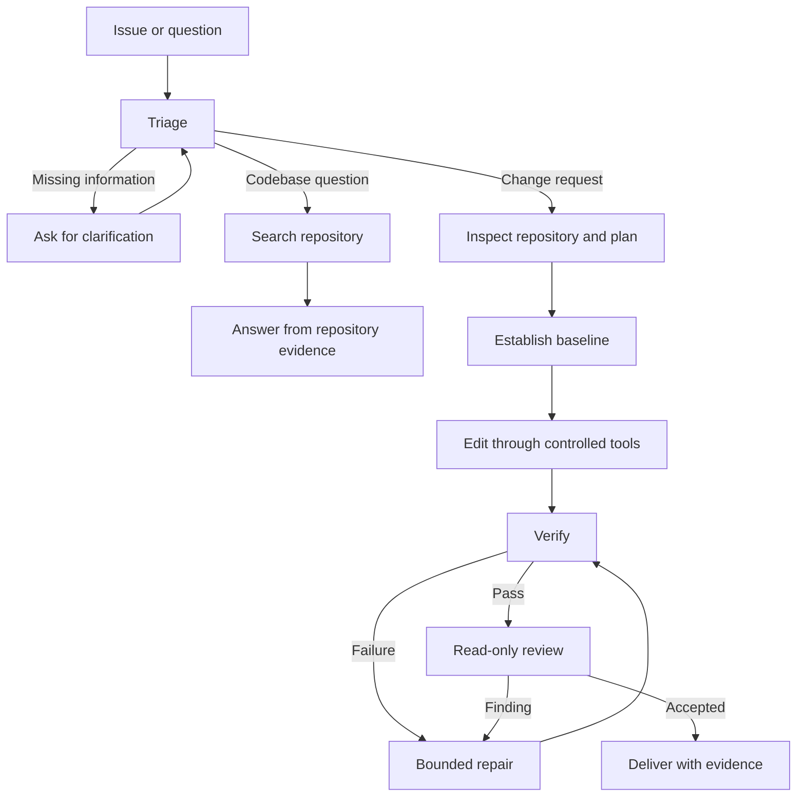

# Target Runtime Architecture

This document describes the intended slop-loop runtime; it is not evidence that runtime components exist. The approved implementation is <!-- context-fact: runtime-language -->TypeScript<!-- /context-fact --> with the official TypeScript <!-- context-fact: orchestrator -->`@langchain/langgraph`<!-- /context-fact --> package for orchestration. See [tech_stack.md](tech_stack.md) for open choices and [progress_checker.md](progress_checker.md) for current repository evidence.

## Authority and ownership

The system follows `Coding Agent = Model + Harness`: the model reasons and proposes; deterministic runtime code controls, authorizes, executes, and verifies.

| Part | Owns |
|---|---|
| Model | Interpret the request, form hypotheses and plans, inspect supplied evidence, propose edits, explain results. A proposal does not authorize execution. |
| Workflow control | Task transitions, persisted state, repair and cost budgets, approval pauses, checkpointing, reviewer coordination, and completion rules. |
| Policy | Classification of actions as allowed, approval-required, or forbidden, plus cross-cutting execution requirements. [tools_permissions.md](tools_permissions.md) is authoritative for permission classes and role access; [runtime_policy.md](runtime_policy.md) defines operational enforcement requirements. |
| Repository tools | Bounded workspace reads, search, controlled patching, approved commands, and test execution. |
| Verification and review | Required checks establish completion; a separate read-only reviewer assesses the final diff and evidence. |

The model does not receive unrestricted filesystem or shell access. State and recovery requirements are in [state_and_memory.md](state_and_memory.md); the contributor process in [workflow.md](workflow.md) does not define runtime transitions.

## Runtime flow

Not every task needs every stage. Triage captures task type, priority, likely affected files, reproduction details, acceptance criteria, missing information, and the next route. If required information is missing, ask instead of inventing assumptions.

## Verification, review, and limits

For changes, establish a pre-edit baseline, apply a controlled patch, run focused and regression checks, check public API compatibility where relevant, and validate the final diff. Review begins only after required verification passes. An applied patch without required passing evidence is incomplete.

The reviewer examines the diff against acceptance criteria and repository conventions for logic errors, edge cases, security concerns, missing tests, and unsupported changes. The reviewer has read-only authority. Reviewer iteration, repair cycles, and expensive actions must have explicit limits; repair uses new tool, test, or review evidence and returns through verification before delivery. When a budget is exhausted or no safe next action exists, stop and report the blocker.

Each run should have traceable workflow-node, tool-call, skill-invocation, result, error, approval, verification, repair, and review records. Record metadata and only sanitized, bounded approved command details under [runtime_policy.md](runtime_policy.md); never include raw prompts, raw tool output, or protected payloads. Record per-run token usage and cost estimates so evaluation can explain how the final state was reached. Target acceptance evidence is listed in [the verification matrices](../docs/progress-checker-matrices.md).
