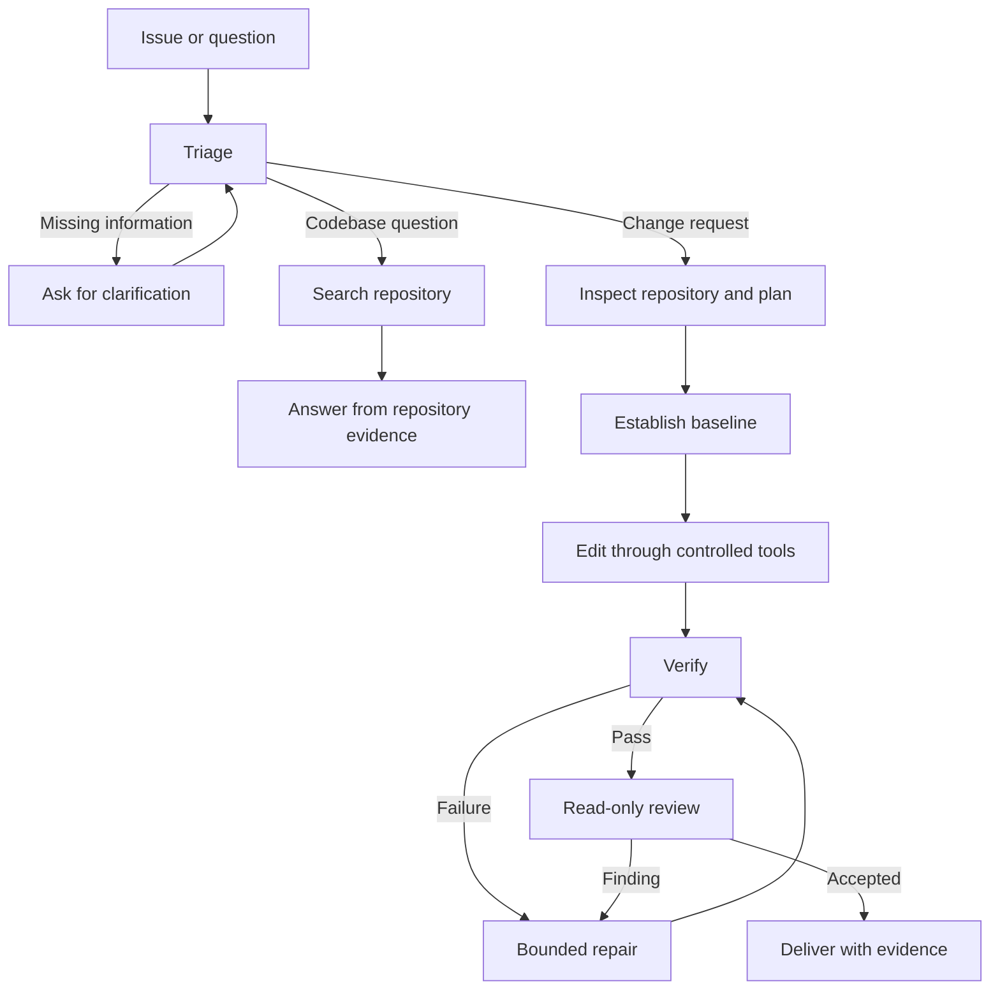

# Target Runtime Architecture

This document describes the intended slop-loop runtime. The stable [UC-03 contract entry](../src/contracts/foundation/uc03.ts) exports both versions from `uc03/v01/` and `uc03/v02/`; `uc03/identity.ts` remains shared. V1 validation is grouped into [intake](../src/contracts/foundation/uc03/v01/validation/intake.ts), [state](../src/contracts/foundation/uc03/v01/validation/state.ts), [provider](../src/contracts/foundation/uc03/v01/validation/provider.ts), [evidence](../src/contracts/foundation/uc03/v01/validation/evidence.ts), [transition](../src/contracts/foundation/uc03/v01/validation/transition.ts), [records](../src/contracts/foundation/uc03/v01/validation/records.ts) and [common checks](../src/contracts/foundation/uc03/v01/validation/common.ts). Intake, state, provider and evidence delegate to concern-specific subfolders; follow only the affected branch. [Contract](../tests/runtime/contract/uc03.test.ts) and [port-conformance tests](../tests/runtime/contract/uc03-port-conformance.test.ts) cover the public entry. The library provides validation and pure admission. T026 positive mock route passes; replan/repair gaps remain. T027 mock evaluation is accepted. See testing.md and progress_checker.md. Real adapters, isolation and C17 remain unverified. The approved implementation is <!-- context-fact: runtime-language -->TypeScript<!-- /context-fact --> with the official TypeScript <!-- context-fact: orchestrator -->`@langchain/langgraph`<!-- /context-fact --> package for orchestration. See [tech_stack.md](tech_stack.md) for open choices and [progress_checker.md](progress_checker.md) for current repository evidence.

Controlled test-only ports in `tests/runtime/support/uc03/` simulate state, approval, model, repository and reviewer behavior with explicit finite profiles and mock provenance. They do not implement the real adapters or execution boundaries described below.

Phase 3 has retained local-only bug/input fixtures under `fixtures/uc03/` (not shipped in the published repository per user preference) and the independently reviewed sanitized telemetry boundary in `src/foundation/telemetry.ts`. Telemetry projects per-run usage, rejects protected identity/reference metadata, and bounds redacted diagnostics; it does not own the cumulative UC-04 budget ledger. The T008 host model boundary in `src/foundation/model.ts` has integrated controlled-mock acceptance for bounded evidence, host-held configuration, reservation and claim before transport, usage settlement and charged uncertain outcomes. The T006 workspace lifecycle already present on the base is extended with a reviewed structured command executor in `src/foundation/docker-workspace.ts`; `tests/runtime/unit/docker-workspace.test.ts` verifies profile-bound command planning, fresh-view checks, environment allowlists and bounded output through an injected fake controller. The module does not provide a real Docker adapter, and these tests do not prove malicious repository code is contained; that proof remains gated by T024. Pure [intake](../src/uc03/input.ts) now accepts explicit caller task data and UC-01 metadata under [receiver v1](../specs/001-verified-code-repair/contracts/uc01-receiver.md), without execution. Investigation/verification remain unchanged. These scoped checks do not establish a runnable repair route, real provider dispatch, actual Docker isolation or durable recovery.

UC-03 [graph composition](../src/uc03/graph.ts) uses [state declarations](../src/uc03/graph-state.ts) and dependency/configuration types in `graph-types.ts`. [Review](../src/uc03/graph-review.ts) exposes only `createReviewNode`, hiding admission, claims, dispatch and completion. [Feedback](../src/uc03/graph-feedback.ts) and [owner transitions](../src/uc03/graph-transitions.ts) own execution; `graph-validation.ts` keeps pure checks. Stage and authority rules are unchanged.

UC-03 Phase 4 adds the injected repair and replan consumers in `src/uc03/repair.ts`, `src/uc03/replan.ts` and `src/uc03/repair-types.ts`. Repair admits current failure diagnostics, bound plan/action authority and persisted repair reservations before guard effects; the guard-confirmed revision is persisted at Verify. Replanning uses explicit trusted admission context, cumulative task accounting and bound human direction after rejection; material revisions charge at most three slots and invalidate active approval/review authority. The public consumer checks use controlled ports only, including forwarding StatePort wrappers; no real adapters, execution isolation or process restart is established.

UC-03 Phase 5 retains local-only adversarial fixtures (T019), mock isolation assertions (T020), the neutral no-dispatch guard/RED checkpoint (T021), and sanitized reporting (T023). T022 and T057-T061 are complete locally after the approved receipt amendment and final R3 reviews. The required v0.2 receiver handoff forwards exact UC-04 claim/attempt/outcome/settled records. The guard validates post-settlement identity, digest, admission and effects, projects the exact owner attempt ID, and never repeats claim/begin/record/consume or retries. Approved patches require Patch -> Verify; commands/diagnostics preserve task state and handoffs carry empty named invalidations. Both ports must declare guard-local v0.2 compatibility and expose the required shape before any port call; the marker grants no policy authority. The v0.1 guard stays no-dispatch even with context. Missing context or unavailable authoritative state fails closed before dispatch; invalid results or unknown post-dispatch exceptions yield uncertain-effect without invented identity. Repair requires supplied authority and leaves reservation, consumption, settlement and revision/Verify accounting with the receiver/UC-04 journal; failed/partial and observed-unsettled paths retain one consumed allowance, pending evidence and lease for exact recovery without refund or reapply. UC-05 mocks transparently forward journal operations and exact owner responses without minting authority. The reporting builder in `src/uc03/report.ts` snapshots and deeply freezes validated reports, recording process-local issuance privately. Markdown accepts only the original builder-issued report; copies and serialization cannot establish completion or review readiness. Public reporting exceptions normalize to fresh fixed errors; this provenance grants no runtime action or restart authority. T024/T025 real containment and approval integration are not run; concrete Docker configuration and a running Linux daemon are absent. These are deterministic mock paths: real adapters, production configuration, durable persistence, actual containment/restart, full Phase 5 and Phase 6 remain gated. T042-T048 remain integrated in the reviewed working tree: the test-only MemoryStatePortV02 journal, additive UC-05 v0.2 receipt validators, policy/provider/action receipt issuance and journal-backed control/admission-only recovery. The journal serializes claim/attempt/outcome/recovery, binds reservations/holds, authenticates closure proofs/fences, and settles approved-plan/diagnostic patches with revision/evidence invalidation. T049-T052 are locally complete after integrated focused verification. They add mock-backed v0.2 repository receivers and provider ingress. The repository facade delegates admission, read holds, authenticated attempts and settlement-held patch leases to `repository-admission.ts`, `repository-read.ts`, `repository-receiver.ts` and `repository-outcome.ts`. Docker workspace modules separate policy, manager, views, command planning and execution; the controller checks the exact actor and current fencing immediately before local one-shot consume. HostModelPortV02/provider-admission authenticates exact claim/attempt/request identity, reuses only exact immutable retries, records observed or charged-uncertain outcomes, and retains recovery evidence when settlement is unverified. Hostile responses cannot mint success; diagnostic patches preserve Investigate and do not charge repair. CodeRabbit round 1 adds canonical outcome recording before lease release, trusted pre-begin closure, fenced patch recovery, concurrent reader wake-up and retry after proven pre-claim denial. Protected-content filtering uses the shared workspace policy. Historical T042-T056 verification is in [testing guidance](testing.md); those reviews precede later changes.

T053-T056 are locally complete; see the [task ledger](../specs/001-verified-code-repair/tasks.md). PR99 round 1 hardens v0.2 target paths, rejects ignored binding/freshness fields, requires configured binding authority, and isolates stale-revision test contexts. Worker source/emitted checks pass 121/121 fixtures and 33/33 CLI. Fresh reviews/merger were skipped at user request after usage-limit failures. The presentation facade reexports `presentation-v02-validation.ts`. T022/T057-T061 evidence is in [testing guidance](testing.md); T062-T065 are locally checked at their mock checkpoints. T066 repair commit `63fa4468a7939f9ed8ae278f1aae785876b8dca0` replays the validated observed-recovery receipt after a lost same-receiver reply; five-file source/emitted suites pass 432/432 and typecheck/build pass. T066 remains unchecked because SPEC-R1-003 has other Section 10 gaps: fresh-receiver recovery, trusted evidence invalidation, dispatch status, public checkpoint/fencing and other audited cases. See [implementation status](progress_checker.md) and the [task ledger](../specs/001-verified-code-repair/tasks.md). R3 review and full acceptance remain pending; real/production/restart/Phase 6 gates remain closed.

UC-05 [contracts](../src/contracts/approvals/contracts.ts) retain a stable entry, with `v01/` and `v02/` internals and unchanged schema identifiers in `versions.ts`. UC-05 has deterministic policy, service/control, exact-binding evaluation, safe presentation/history and CLI in `src/approvals/`. T016–T018 were separately authorized on 2026-10-22 (Asia/Saigon); authorization and earlier phase agreements remain in [decisions](../specs/003-uc05-human-approval/contracts/decisions.md). The four canonical ApprovalPort signatures remain unchanged; cohesive service helpers separate context admission, pending requests, decisions and directions. Exact stale projections preserve immutable human resolutions, the digest of the admitted assessment context and waiting replacement barriers; injected-port errors cannot supply stale authority. Canonical plan-consumer checks retain baseline/replan and separate risky-action boundaries. The service's read-only `history(taskId, page)` and explicit CLI history command expose bounded metadata with snapshot identity, distinct committed journal evidence, derived current assessments and optional validated owner activity observations. A failed current-detail provider yields unknown history observations without closing later binding validation or attempt admission; authoritative store read failures still close admission. Missing execution/cancellation evidence stays unknown; approval, claims and observed effects never imply verified task completion. Request/decision authority requires matching journal evidence, including on reconstructed consumers; missing/inconsistent receipts remain closed. Tai's telemetry and UC-04 persistence/execution ownership are unchanged. The earlier mock continuation consumer in `recovery.ts`, exposed through `control.ts`, retains owner claims, cumulative reservations and replay fences. Direct CLI composition stays unavailable. Evidence remains mock/local, including reconstruction from retained in-memory owner state. No durable atomicity, real adapter/profile, repository effect or actual process restart is established; Phase 8 T019–T022 is separately authorized on 2026-10-22 (Asia/Saigon); T019 now provides a UC-scoped identity-bearing two-run local catalog with partial witnesses for C01–C24 and all 104 required real/restart vectors not-run, while T020–T022 retain external prerequisites and G-PROFILE/G-REAL/G-RESTART remain unmet. Planned preparation tiers are recorded separately from observed local tiers derived from explicitly mapped unit/mock/CLI witnesses. Latest upstream inspection found UC-04 foundation candidate `798942d` outside development: its one file-reload/process-lifecycle fixture passes, but a compatible UC-05 ApprovalStore adapter, real UC-03 admission/executor and approved integration profiles remain absent; T020–T022 stay gated.

## Authority and ownership

The system follows `Coding Agent = Model + Harness`: the model reasons and proposes; deterministic runtime code controls, authorizes, executes, and verifies.

| Part | Owns |
|---|---|
| Model | Interpret the request, form hypotheses and plans, inspect supplied evidence, propose edits, explain results. A proposal does not authorize execution. |
| Workflow control | Task transitions, persisted state, repair and cost budgets, approval pauses, checkpointing, reviewer coordination, and completion rules. |
| Policy | Classification of actions as allowed, approval-required, or forbidden, plus cross-cutting execution requirements. [tools_permissions.md](tools_permissions.md) is authoritative for permission classes and role access; [runtime_policy.md](runtime_policy.md) defines operational enforcement requirements. |
| Repository tools | Bounded workspace reads, search, controlled patching, approved commands, and test execution. |
| Verification and review | Required checks establish completion; a separate read-only reviewer assesses the final diff and evidence. |

The model does not receive unrestricted filesystem or shell access. State and recovery requirements are in [state_and_memory.md](state_and_memory.md); the contributor process in [workflow.md](workflow.md) does not define runtime transitions.

## Runtime flow

For the first local UC-03 slice, the trusted host owns the agent loop, LangGraph, task state/checkpoints, policy, model proxy and credentials, Docker controller, and hidden grading. A fresh Docker task container holds the repository copy at /workspace/repo, scratch area at /workspace/scratch, Python, pytest, and prepared dependencies. Reuse the prepared image across tasks, but never share writable task state between different tasks. Task containers have no network access. Host-side tools invoke Docker's existing execution interface after policy checks; no separate REST or gRPC service is required for this slice. See [ADR-0003](../docs/adr/0003-docker-task-workspace-boundary.md).

UC-03 uses adaptive reasoning and permitted tool calls within harness-enforced high-level stages. Before production-code edits, record acceptance criteria, reproduction/baseline evidence, required checks, and a fix plan, then obtain human approval of the diagnosis and plan. A new regression test may be added during reproduction without weakening existing tests. Every material strategy replan requires renewed human approval before edits under that strategy. Allow at most three material replans after the initial plan per task; rejected plans wait for user feedback. Minor implementation adjustments do not count as replans. See [ADR-0004](../docs/adr/0004-uc03-adaptive-workflow-and-replan-limit.md).

The general flow below describes stage ordering; the UC-03 MVP additionally pauses for plan approval before editing and for renewed approval after a material replan.

Not every task needs every stage. UC-01 assesses one supplied issue/repository: classification, impact-based P0–P3 or undetermined severity, evidence, missing information and a configured destination recommendation. Recommend without dispatching; business priority remains separate. Preserve reporter claims separately from inspected evidence, omit a separate prompt-rewriting call, and request clarification when missing information could materially change intended behavior, scope, or route. UC-01 consumes Tai's shared foundation; UC-03 retains debugging and repair, UC-04 durable recovery, and UC-05 action approval. UC-01 implements contract validation, intake, clarification, configured recommendation and assessment in src/uc01/. The controller accepts only the explicit controlled fixture profile and mock ports: it admits exact-digest protected-data-checked excerpts, guards bounded read/search and model requests, reserves/settles usage, validates citations and impact dimensions, and binds material questions through the injected caller port. Later invocations resolve the opaque continuation before excerpt admission or constrained activity, compare the immutable question/report/snapshot/config binding, preserve unanswered questions, and reassess with answer-origin evidence and current admitted findings. Clarification supplies no action approval; shared ports retain cumulative task accounting across invocation/run IDs, including uncertain reservations. Recommendation validates configured classification compatibility and evidence-linked responsibility inference without dispatch. Empty or unsupported catalogs preserve uncertainty; unresolved compatible destination ambiguity returns undetermined with a material question. Clarification projection precedes recommendation so unanswered destination questions remain binding; generated questions and rationale obey the existing finite output limits. Controlled fixtures under tests/runtime/support/uc01 establish local behavior only. The T014 safety suite in tests/runtime/uc01/safety.test.ts consolidates adversarial and finite-execution regressions through those same mock consumer seams; it leaves runtime code and the frozen fixture dataset unchanged and supplies no real containment or process-restart evidence. Real adapters, durable policy/accounting/restart, provider quality, shared evaluation and dispatch are not implemented by this slice; see [ADR-0005](../docs/adr/0005-uc01-triage-boundary-and-assessment.md) and the [delegation map](../docs/use-case-delegation.md).

## Verification, review, and limits

For changes, establish a pre-edit baseline, apply a controlled patch, run focused and regression checks, check public API compatibility where relevant, and validate the final diff. Review begins only after required verification passes. An applied patch without required passing evidence is incomplete.

The reviewer examines the diff against acceptance criteria and repository conventions for logic errors, edge cases, security concerns, missing tests, and unsupported changes. The reviewer has read-only authority. Reviewer iteration, repair cycles, and expensive actions must have explicit limits; repair uses new tool, test, or review evidence and returns through verification before delivery. When a budget is exhausted or no safe next action exists, stop and report the blocker.

Each run should have traceable workflow-node, tool-call, skill-invocation, result, error, approval, verification, repair, and review records. Record metadata and only sanitized, bounded approved command details under [runtime_policy.md](runtime_policy.md); never include raw prompts, raw tool output, or protected payloads. Record per-run token usage and cost estimates so evaluation can explain how the final state was reached. Target acceptance evidence is listed in [the verification matrices](../docs/progress-checker-matrices.md).
