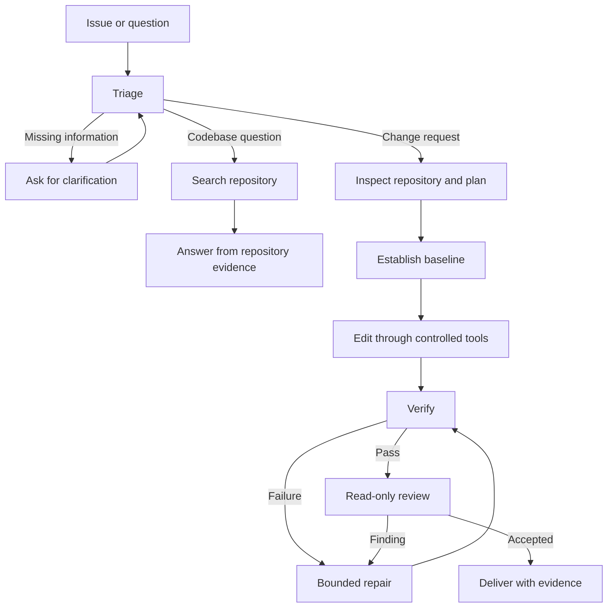

# Target Runtime Architecture

This document describes the intended slop-loop runtime. The canonical UC-03 contract API is [src/contracts/foundation/uc03.ts](../src/contracts/foundation/uc03.ts). Validator routes are grouped by concern: [validation/intake.ts](../src/contracts/foundation/uc03/validation/intake.ts) delegates task, action, command-view, and limit checks to [validation/intake/](../src/contracts/foundation/uc03/validation/intake/); [validation/state.ts](../src/contracts/foundation/uc03/validation/state.ts) delegates task and budget checks to [validation/state/](../src/contracts/foundation/uc03/validation/state/); [validation/provider.ts](../src/contracts/foundation/uc03/validation/provider.ts) delegates request, record, and admission checks to [validation/provider/](../src/contracts/foundation/uc03/validation/provider/); [validation/evidence.ts](../src/contracts/foundation/uc03/validation/evidence.ts) delegates baseline, review, source, and verification checks to [validation/evidence/](../src/contracts/foundation/uc03/validation/evidence/). [validation/transition.ts](../src/contracts/foundation/uc03/validation/transition.ts), [validation/records.ts](../src/contracts/foundation/uc03/validation/records.ts), and [validation/common.ts](../src/contracts/foundation/uc03/validation/common.ts) contain transition, record, and shared primitive checks. Follow only the affected branch; [UC-03 contract tests](../tests/runtime/contract/uc03.test.ts) and [port-conformance tests](../tests/runtime/contract/uc03-port-conformance.test.ts) cover the public validation boundary. The library implements schema validation and pure admission against trusted context; runtime flow, real adapters, and kernel-enforced isolation remain target design. The approved implementation is <!-- context-fact: runtime-language -->TypeScript<!-- /context-fact --> with the official TypeScript <!-- context-fact: orchestrator -->`@langchain/langgraph`<!-- /context-fact --> package for orchestration. See [tech_stack.md](tech_stack.md) for open choices and [progress_checker.md](progress_checker.md) for current repository evidence.

Controlled test-only ports in `tests/runtime/support/uc03/` simulate state, approval, model, repository and reviewer behavior with explicit finite profiles and mock provenance. They do not implement the real adapters or execution boundaries described below.

Phase 3 has retained local-only bug/input fixtures under `fixtures/uc03/` (not shipped in the published repository per user preference) and the independently reviewed sanitized telemetry boundary in `src/foundation/telemetry.ts`. Telemetry projects per-run usage, rejects protected identity/reference metadata, and bounds redacted diagnostics; it does not own the cumulative UC-04 budget ledger. The T008 host model boundary in `src/foundation/model.ts` has integrated controlled-mock acceptance for bounded evidence, host-held configuration, reservation and claim before transport, usage settlement and charged uncertain outcomes. The T006 workspace lifecycle already present on the base is extended with a reviewed structured command executor in `src/foundation/docker-workspace.ts`; `tests/runtime/unit/docker-workspace.test.ts` verifies profile-bound command planning, fresh-view checks, environment allowlists and bounded output through an injected fake controller. The module does not provide a real Docker adapter, and these tests do not prove malicious repository code is contained; that proof remains gated by T024. Other Phase 3 boundaries remain under implementation and review. These scoped checks do not establish a runnable repair route, real provider dispatch, actual Docker isolation or durable recovery.

UC-03 Phase 4 adds the injected repair and replan consumers in `src/uc03/repair.ts`, `src/uc03/replan.ts` and `src/uc03/repair-types.ts`. Repair admits current failure diagnostics, bound plan/action authority and persisted repair reservations before guard effects; the guard-confirmed revision is persisted at Verify. Replanning uses explicit trusted admission context, cumulative task accounting and bound human direction after rejection; material revisions charge at most three slots and invalidate active approval/review authority. The public consumer checks use controlled ports only, including forwarding StatePort wrappers; no real adapters, execution isolation or process restart is established.

UC-05 has companion validators in `src/contracts/approvals/contracts.ts`, deterministic policy, service/control, safe presentation/CLI and exact-binding evaluation in `src/approvals/`. T011–T013 were separately authorized with three confirmed evaluator/service/canonical-consumer seams on 2026-10-20 (Asia/Saigon), including user-relayed Tai/X03-PLAN-CONTEXT agreement. T014–T015 and their service/control mock-recovery seam were separately authorized on 2026-10-21 (Asia/Saigon); T016–T022 require separate authorization. The service evaluates all canonical freshness fields, projects stale approvals without changing human resolutions, and replaces stale pending requests through the existing injected store transaction while retaining the wait. Retired request IDs cannot revive after digest reversion; fresh approval uses a fresh identity, without automatically charging unchanged strategy as a replan. Existing mock task fencing, explicit directions and actual CLI subprocess behavior remain covered. Injected-port exceptions are normalized to unavailable and initial lookup receipts are admitted before property reads (T025/T026), preventing stale authority or raw reasons from port failures. Pending replacement assessments retain the digest of the exact admitted old-request context that produced stale reasons (T027), without reloading context or exposing it through errors. Approved staleness is a derived read projection; the store has no terminal-assessment write port. Pending replacement assessments use the existing mock transaction. No real admission/isolation/effects, production profile/adapter, durability or actual runtime restart is established. Direct executable composition remains unavailable. Phase 6 adds the mock-only continuation consumer in `src/approvals/recovery.ts`, exposed through `control.ts`, with 18 recovery vectors and 19 independent merger reproductions. It composes actual service approval validation with retained owner claim/control state and canonical in-memory reservations, rejects malformed or mismatched receipts, and fences replay after lost responses, uncertainty or new runs. Detailed prerequisite diagnostics remain T016–T018; no full restart acceptance follows.

## Authority and ownership

The system follows `Coding Agent = Model + Harness`: the model reasons and proposes; deterministic runtime code controls, authorizes, executes, and verifies.

| Part | Owns |
|---|---|
| Model | Interpret the request, form hypotheses and plans, inspect supplied evidence, propose edits, explain results. A proposal does not authorize execution. |
| Workflow control | Task transitions, persisted state, repair and cost budgets, approval pauses, checkpointing, reviewer coordination, and completion rules. |
| Policy | Classification of actions as allowed, approval-required, or forbidden, plus cross-cutting execution requirements. [tools_permissions.md](tools_permissions.md) is authoritative for permission classes and role access; [runtime_policy.md](runtime_policy.md) defines operational enforcement requirements. |
| Repository tools | Bounded workspace reads, search, controlled patching, approved commands, and test execution. |
| Verification and review | Required checks establish completion; a separate read-only reviewer assesses the final diff and evidence. |

The model does not receive unrestricted filesystem or shell access. State and recovery requirements are in [state_and_memory.md](state_and_memory.md); the contributor process in [workflow.md](workflow.md) does not define runtime transitions.

## Runtime flow

For the first local UC-03 slice, the trusted host owns the agent loop, LangGraph, task state/checkpoints, policy, model proxy and credentials, Docker controller, and hidden grading. A fresh Docker task container holds the repository copy at /workspace/repo, scratch area at /workspace/scratch, Python, pytest, and prepared dependencies. Reuse the prepared image across tasks, but never share writable task state between different tasks. Task containers have no network access. Host-side tools invoke Docker's existing execution interface after policy checks; no separate REST or gRPC service is required for this slice. See [ADR-0003](../docs/adr/0003-docker-task-workspace-boundary.md).

UC-03 uses adaptive reasoning and permitted tool calls within harness-enforced high-level stages. Before production-code edits, record acceptance criteria, reproduction/baseline evidence, required checks, and a fix plan, then obtain human approval of the diagnosis and plan. A new regression test may be added during reproduction without weakening existing tests. Every material strategy replan requires renewed human approval before edits under that strategy. Allow at most three material replans after the initial plan per task; rejected plans wait for user feedback. Minor implementation adjustments do not count as replans. See [ADR-0004](../docs/adr/0004-uc03-adaptive-workflow-and-replan-limit.md).

The general flow below describes stage ordering; the UC-03 MVP additionally pauses for plan approval before editing and for renewed approval after a material replan.

Not every task needs every stage. UC-01 planning now assigns Thai an assessment of one supplied issue for one selected repository: classification, impact-based P0–P3 severity recommendation (or undetermined), rationale, evidence, missing information, and a recommendation from application-configured backend destinations. Recommend without dispatching; business priority remains separate. Preserve reporter claims separately from inspected evidence, omit a separate prompt-rewriting call, and request clarification when missing information could materially change intended behavior, scope, or route. UC-01 consumes Tai's shared foundation; UC-03 retains debugging and repair, UC-04 durable recovery, and UC-05 action approval. UC-01 has contract validators in src/uc01/contracts.ts, IntakeBinder in src/uc01/intake.ts, question/answer projection in src/uc01/clarify.ts, configured recommendation in src/uc01/recommend.ts, and the IssueAssessor controller in src/uc01/assess.ts. The controller accepts only the explicit controlled fixture profile and mock ports: it admits exact-digest protected-data-checked excerpts, guards bounded read/search and model requests, reserves/settles usage, validates citations and impact dimensions, and binds material questions through the injected caller port. Later invocations resolve the opaque continuation before excerpt admission or constrained activity, compare the immutable question/report/snapshot/config binding, preserve unanswered questions, and reassess with answer-origin evidence and current admitted findings. Clarification supplies no action approval; shared ports retain cumulative task accounting across invocation/run IDs, including uncertain reservations. Recommendation validates configured classification compatibility and evidence-linked responsibility inference without dispatch. Empty or unsupported catalogs preserve uncertainty; unresolved compatible destination ambiguity returns undetermined with a material question. Clarification projection precedes recommendation so unanswered destination questions remain binding; generated questions and rationale obey the existing finite output limits. Controlled fixtures under tests/runtime/support/uc01 establish local behavior only. The T014 safety suite in tests/runtime/uc01/safety.test.ts consolidates adversarial and finite-execution regressions through those same mock consumer seams; it leaves runtime code and the frozen fixture dataset unchanged and supplies no real containment or process-restart evidence. Real adapters, durable policy/accounting/restart, provider quality, shared evaluation and dispatch are not implemented by this slice; see [ADR-0005](../docs/adr/0005-uc01-triage-boundary-and-assessment.md) and the [delegation map](../docs/use-case-delegation.md).

## Verification, review, and limits

For changes, establish a pre-edit baseline, apply a controlled patch, run focused and regression checks, check public API compatibility where relevant, and validate the final diff. Review begins only after required verification passes. An applied patch without required passing evidence is incomplete.

The reviewer examines the diff against acceptance criteria and repository conventions for logic errors, edge cases, security concerns, missing tests, and unsupported changes. The reviewer has read-only authority. Reviewer iteration, repair cycles, and expensive actions must have explicit limits; repair uses new tool, test, or review evidence and returns through verification before delivery. When a budget is exhausted or no safe next action exists, stop and report the blocker.

Each run should have traceable workflow-node, tool-call, skill-invocation, result, error, approval, verification, repair, and review records. Record metadata and only sanitized, bounded approved command details under [runtime_policy.md](runtime_policy.md); never include raw prompts, raw tool output, or protected payloads. Record per-run token usage and cost estimates so evaluation can explain how the final state was reached. Target acceptance evidence is listed in [the verification matrices](../docs/progress-checker-matrices.md).
