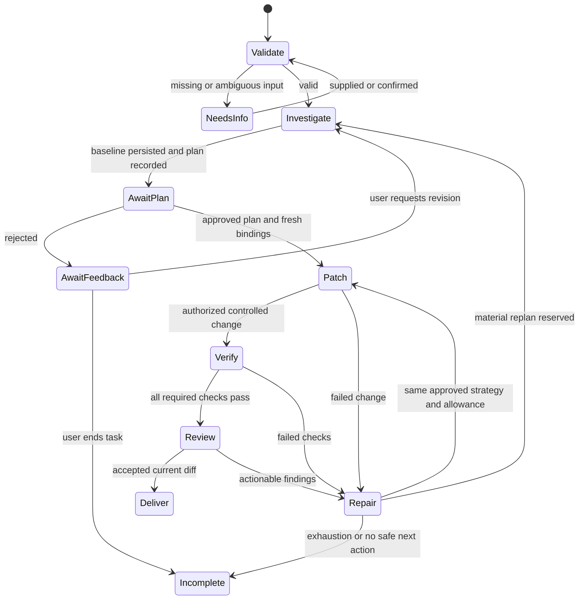

# Data Model: UC-03

Draft v0.1 for T001 signoff. These are logical records, not executable code, database migrations or a UC-04 schema implementation. All external/persisted/model input is validated as unknown before use. IDs are stable opaque strings; revisions/digests identify the exact data checked. T003 owns canonical validators.

## Entities and invariants

| Record | Fields and relationships | Validation / ownership |
|---|---|---|
| BugTask | taskId, repositoryId, initial revision/worktree digest, goal, observed/expected behavior, reproduction steps, acceptance criteria, constraints, required check IDs, task limits/config ID | Nonempty required input; reproducible seeded case; ambiguity requests confirmation. UC-03 intake, durable state by UC-04 |
| TaskWorkspace | taskId, workspaceId, container/image digest, repo/scratch volume identities, expected repository state | New task gets new writable state; resumed task validates identity; no host/agent/private mounts. Tai foundation with UC-04 recovery |
| CommandView | viewId/digest, task/workspace ID, canonical revision/worktree digest, admitted file digests, exclusions-policy version, scratch identity | Trusted foundation excludes protected content before copying; allowed source/tests byte-identical and command-mounted read-only; only scratch writable. Changed canonical state invalidates view |
| ProviderRequest | providerRequestId, task/run/role, purpose, provider/model/config/pricing identities, context digest, finite token/cost/time ceilings, reservation/settlement refs, dispatch state, observed usage or uncertain outcome | Tai ModelPort/reviewer consumes UC-04 durable accounting; reserve before provider network call, settle observed billable usage, keep unknown usage charged and reconcile before retry |
| Run | runId, taskId, start/end, usage/cost, outcome | New run never creates fresh task allowance; missing accounting denies constrained operation |
| TaskState | schemaVersion, stateVersion, task/run/workspace IDs, goal/criteria/constraints, node, plan/step state, changed paths, evidence refs, approvals/review, risks, next action, outcome | Compare-and-swap transition; all original task context survives recovery. UC-04 stores; UC-03 proposes updates |
| PlanStep | stepId, description, status todo/doing/done/failed, action/evidence refs | Harness-owned states; completed work is not blindly replayed |
| FixPlan | planVersion, diagnosis, suspected cause/locations, evidence refs, strategy, scoped changes, check-set digest, baseline ref, strategy digest, decisionRef | Baseline and criteria before production edits; material strategy change creates new version and allowance charge; wording metadata does not |
| ApprovalBinding | decisionId, kind action/fix-plan, normalized action digest, task/workspace/repo identity/state, policy ID/version, planVersion/strategy digest where applicable, status pending/approved/rejected/stale | UC-05 evaluates; UC-04 persists. Exact proposal in interfaces.md; plan permission does not replace action gate |
| BudgetLedger | scope task/run, kind, finite limit, consumed, reservations keyed by action/replan/provider request ID, unit, configuration ID, version | UC-04 atomically reserves before operation; unresolved reservations remain charged. Nonnegative, no unlimited/NaN/absent amounts. Remaining = limit - consumed - outstanding reservations |
| Baseline | evidenceId, repository snapshot, check-set, reproduction failure signature, check results including previously passing test IDs, test-protection digest | Persist before production edit; separate expected bug failure from environment/pre-existing failure |
| VerificationResult | evidenceId, task/run/action IDs, phase baseline/focused/regression/compatibility/diff, repo/diff digest, command identity, outcome pass/fail/timeout/error/not-run, tested IDs, bounded diagnostic refs | Pass requires actual executed required check, exact state and finite limits. Failed/absent/stale evidence cannot pass completion |
| SourceEvidence | path, revision/content digest, bounded redacted excerpt, result counts, truncation marker | Tools validate path and content; approved excerpt reaches model/reviewer as untrusted data. Trace stores refs/metadata, not bodies |
| ReviewResult | reviewId, distinct role config, repo/diff/check-set digests, status accepted/findings/invalid, findings with file/line/severity/evidence, iteration reservation | Real changed files/lines validated; read-only tool authority; repairs invalidate old review |
| ActivityEvent | event/task/run IDs, time, node, action/type, outcome, policy/decision/evidence refs, duration, safe counts, usage/cost | Sanitized bounded fields; no prompts, raw streams, secrets or reasoning transcript |
| Delivery | task/run IDs, outcome, diff digest, changed files, baseline/check/review refs, limitations, safe next action | Complete only by deterministic predicate below. Product outcome is separate from project capability status |

## High-level state transitions

Approval-required tool actions interrupt any eligible stage at the exact action via UC-05, not a parallel UC-03 policy engine. Forbidden actions return denial before effects. Safety/configuration errors stop the affected route with sanitized evidence. Awaiting plan/user/action approval is a resumable pause, not completion.

A material replan is a meaningful change of fix strategy based on new evidence or requested feedback. Reserve one of three task-scoped replan slots before recording/attempting the strategy; settlement consumes the slot even if its human decision is rejected. The initial plan has replan count zero. Persist a unique proposal ID so retrying persistence does not charge twice. Wording clarification and adjustments within the approved strategy do not charge. This precise accounting is proposed for joint UC-04/UC-05 signoff at T001; no refund on restart or rejection is assumed.

Provider accounting follows the host-provider protocol in contracts/interfaces.md for both model roles. Termination after reservation or network dispatch retains token/cost charges until UC-04 reconciles the request; neither a new run nor post-call estimates authorize replay. Restored command views must still match canonical state and admission policy.

Resume is an overlay on any persisted node: restore through UC-04, check repo/workspace/policy bindings, reconcile reservations/effects, invalidate stale decisions/evidence, then continue at a safe next action. Missing accounting halts the affected operation. UC-03 does not implement the recovery storage/replay engine.

## Completion predicate and invalidation

Delivery is complete only if input/criteria are agreed, pre-fix reproduction/baseline exists, the scoped final diff is authorized, all required focused/existing/regression/compatibility/diff checks pass for that state, existing tests remain protected, and validated read-only review accepts that state. Hidden grading supplies independent evaluation evidence; it never grants coder access.

A changed repo/diff/check-set invalidates affected verification and review. A material plan change invalidates plan edit permission; repo/policy/action changes invalidate applicable UC-05 decisions. Harness requires revalidation rather than a model assertion. Incomplete required verification after applied changes is reported as `IMPLEMENTED_UNVERIFIED`; project capability remains unverified until the full real acceptance evidence is reviewed.
