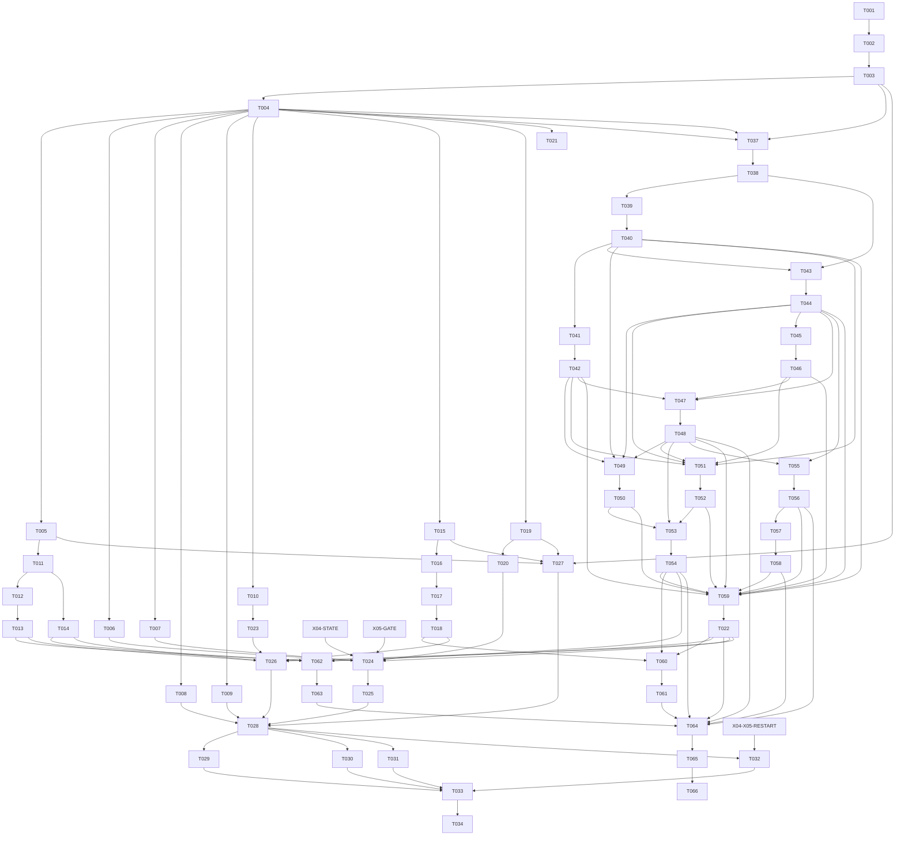

# Tasks: UC-03 — Verified Code Repair

**Input**: Design documents from `/specs/001-verified-code-repair/`.
**Prerequisites**: [plan.md](plan.md), [spec.md](spec.md), [research.md](research.md), [data-model.md](data-model.md), [interfaces](contracts/interfaces.md), [acceptance](contracts/acceptance.md).
**Status**: Phase 1 (T001–T002) completed; Phase 2 (T003–T004) authorized on 2026-10-16 (Asia/Saigon); Phase 3 (T005–T014) authorized on 2026-10-18; Phase 4 (T015–T018) authorized on 2026-10-21; and Phase 5 (T019–T025) authorized on 2026-10-22. Real-only T024–T025 prerequisites and Phase 6 remain gated. The atomic-admission design and task preparation were approved on 2026-10-22; revised tasks T037–T066 are a draft awaiting two independent planning reviews, and no runtime implementation is released. Completion is recorded only after integrated checks; see [decisions](contracts/decisions.md).
**Tests**: Required by FR-013 and repository test-first guidance. Each implementation task demonstrates its behavioral RED before GREEN; a missing module/collection failure is not a valid behavioral RED. Bootstrap commands are available in quickstart.md; behavioral product-runtime commands remain future work.
**Phase 1 evidence**: [Initial verification](https://github.com/pminhtaiii/slop-loop/blob/ee5be9b147efb44511b8e65ece375fc904c5f062/docs/verification/2026-10-16-verified-code-repair-phase1.md) records integrated checks and independent review for T001–T002. Current pnpm verification and future evidence outputs under `docs/verification/` are intentionally local-only and must not be force-added. The T019–T025 authorization is historical and does not release T026–T034 or the separate amendment implementation.
**Organization**: User-story phases follow Spec Kit; priorities do not override DAG edges or permit delayed safety gates. US3 is P1 despite its section position. Final phase integrates all stories.

## Format: `[ID] [P?] [Story] Description`

The historical IDs T001–T036 retain their statuses. The amendment adds proposed IDs T037–T066; these remain unchecked until implementation is separately released and verified. `[P]` means disjoint owned files and parallel eligibility **only at a ready frontier with all listed dependencies already satisfied**; it never bypasses prerequisites. Dependencies below are authoritative edges, not phase-wide barriers. Only checked tasks with integrated verification evidence count as completed dependencies.

Tai is accountable for all local tasks, including shared foundation. Named lanes (contracts, tools, model, reviewer, workflow, evaluation) describe possible future delegation under Tai; they do not assign new colleagues. Thanh Tan and Trong Tan own external deliverables only. Parallel opportunities assume Tai delegates disjoint ready work; no worker gets remote authority. Only the coordinator changes checkboxes after integrated evidence passes.

## Phase 1: Setup (Shared Infrastructure)

- [X] T001 Record reviewed decisions and owner agreement in specs/001-verified-code-repair/contracts/decisions.md before implementation.
  - **Owner**: Tai, coordinating Thanh Tan (UC-04) and Trong Tan (UC-05).
  - **Dependencies**: None; review task can start immediately.
  - **Owned Paths**: specs/001-verified-code-repair/contracts/decisions.md; plan.md; research.md; data-model.md; contracts/interfaces.md; tasks.md (coordinator-only approval amendments).
  - **Acceptance Checks**: Record accepted feature/contract v0.1 revisions, shared path ownership, Tai's reviewer responsibility, UC-05 fix-plan binding and UC-04 accounting semantics; resolve placeholder constitution governance and preserve the accepted ADR-0004 decisions from upstream 5a81b3a; obtain agreement on concrete binding/accounting rather than reopen accepted behavior. Record exact bootstrap toolchain choices. Per the user-approved Phase 1 amendment, provider/storage/platform/isolation/retention/evaluation choices and finite trusted production configuration may remain explicit release blockers before real execution, rather than blockers to T002 build setup. Link actual foreign ledgers when available; do not fabricate external task IDs. Revise draft if owners disagree; no runtime edits under unresolved choices.

- [X] T002 Establish the selected strict TypeScript/LangGraph build in package.json, tsconfig.json and the selected lockfile.
  - **Owner**: Tai / bootstrap lane.
  - **Dependencies**: T001.
  - **Owned Paths**: package.json; tsconfig.json; selected package-manager lockfile; selected lint/build config; .github/workflows/runtime-checks.yml.
  - **Acceptance Checks**: Install only selected versions; document exact build, focused runtime-test, lint and strict compiler commands in quickstart.md through coordinator handoff. CI runs strict compiler and mechanical lint. Existing contributor helpers stay runnable. No provider secret in repository config. A scaffold is not UC-03 acceptance.

## Phase 2: Foundational (Minimal Development Prerequisites)

- [X] T003 Implement canonical contract validators and conformance vectors in src/contracts/foundation/uc03.ts and tests/runtime/contract/uc03.test.ts.
  - **Owner**: Tai / contracts lane; UC-04/UC-05 owners review their ports.
  - **Dependencies**: T001, T002.
  - **Owned Paths**: src/contracts/foundation/uc03.ts; tests/runtime/contract/uc03.test.ts.
  - **Acceptance Checks**: Behavioral tests reject malformed input/model/review/checkpoint/action data, invalid finite limits, stale digests and invalid transitions; agree envelope/version and typed outcomes from interfaces.md. One schema suite applies unchanged to mocks and real adapters. No persistence or approval implementation here. Include CommandView admission/digest and ProviderRequest role, finite ceilings, pre-dispatch reservation refs, observed/uncertain usage vectors from the revised data model; no provider call may accept a post-call estimate as authority.

- [X] T004 Build controlled port mocks in tests/runtime/support/uc03/ and verify them in tests/runtime/contract/uc03-mocks.test.ts.
  - **Owner**: Tai / test-support lane.
  - **Dependencies**: T003.
  - **Owned Paths**: tests/runtime/support/uc03/; tests/runtime/contract/uc03-mocks.test.ts.
  - **Acceptance Checks**: MemoryStatePort, ScriptedApprovalPort, ScriptedModelPort, FakeRepositoryPort and ScriptedReviewerPort pass accepted schema vectors; cover CAS conflict, reservations, stale/denied decisions, failures and partial evidence with explicit finite profiles. No real commands/network/durable-store claim. Mark mock provenance and reject production fallback. Replacement tasks T025/T028/T030/T032 are documented. State mocks support atomic multi-budget reservation and interrupted provider requests; model/reviewer spies count attempted dispatches, including zero-call missing/exhausted-budget cases. These remain simulated accounting, not real durability evidence.

**Checkpoint**: After T004, all three stories can develop independently against the same contracts. Real shared components below are not prerequisites for mock-backed story work. Contract signoff is not a claim those components exist.

## Phase 3: User Story 1 - Receive a verified localized fix (Priority: P1)

**Goal**: Validated task to evidence-backed final result. **Independent Test**: C01/C02/C16 through the injected route; real acceptance at T028. The mock milestone alone is not a delivered verified fix.

- [X] T005 [P] [US1] Prepare public seeded bug and input fixtures in fixtures/uc03/success/ and fixtures/uc03/input/.
  - **Owner**: Tai / evaluation-fixture lane.
  - **Dependencies**: T004.
  - **Owned Paths**: fixtures/uc03/success/; fixtures/uc03/input/.
  - **Acceptance Checks**: Task declares reproduction/criteria/check-set; public Python/pytest source has localized bug, failing reproduction and required existing passing checks. Include missing/ambiguous input, non-reproduction and collection-error vectors. No hidden answers in agent-visible files; no pytest execution until real guard is integrated (T024/T028).

- [ ] T006 [P] [US1] Build Docker workspace lifecycle and structured executor in src/foundation/docker-workspace.ts.
  - **Owner**: Tai / container lane (shared foundation).
  - **Dependencies**: T004.
  - **Owned Paths**: src/foundation/docker-workspace.ts; tests/runtime/unit/docker-workspace.test.ts; docker/uc03/Dockerfile; docker/uc03/profile.json.
  - **Acceptance Checks**: Test-first fake-controller checks enforce the interfaces.md command-view boundary: canonical repository writable only by trusted patches without repository-code execution, protected paths/content excluded before view creation, byte-identical admitted source/tests mounted read-only for every repository command, only scratch writable, no writable source overlay or canonical-volume access. Enforce non-root/read-only root, prepared image, network none, finite resources and absent host/socket/credential/grader mounts. Reject stale views and required files with protected content; no silent executable-source redaction. Preserve canonical workspace identity through UC-04 resume and invalidate derived views on change. Actual malicious-pytest read/write/isolation proof awaits T024; no real repository execution before that gate.

- [ ] T007 [P] [US1] Implement controlled repository operations in src/foundation/repository-tools.ts.
  - **Owner**: Tai / repository-tools lane (shared foundation).
  - **Dependencies**: T004.
  - **Owned Paths**: src/foundation/repository-tools.ts; tests/runtime/unit/repository-tools.test.ts.
  - **Acceptance Checks**: Test-first injected-executor suite covers list/read/search/unified patch, test commands and diff inspection; canonical paths and new-file parents rechecked; protected paths/content sanitized or denied; existing tests cannot be weakened; patch breadth and argv validated without shell. Tool calls require ExecutionGuard capability, never expose raw process access. Use T004 ports/executor spy until T024. Trusted patch path never runs repository hooks/plugins with writable canonical access. Build/check admitted command-view digests, exclude protected content before copying and reject stale or semantically changed source; commands get no canonical writable mount. Verify failed pytest write attempts cannot be promoted from scratch into canonical source/tests.

- [ ] T008 [P] [US1] Implement validated host model boundary in src/foundation/model.ts.
  - **Owner**: Tai / model lane (shared foundation).
  - **Dependencies**: T004.
  - **Owned Paths**: src/foundation/model.ts; tests/runtime/unit/model.test.ts.
  - **Acceptance Checks**: Invalid outputs cannot dispatch tools; validated proposals receive approved bounded evidence/provenance and usage/cost; provider config stays on host. Test provider stub errors/timeouts/injection handling. T028 separately exercises real configured model; no delegated coding-agent product. Implement the host-provider budget protocol in interfaces.md for every coder request: stable providerRequestId, enforced conservative input/output token/cost ceilings and pricing/config IDs, atomic UC-04 reservation before network, observed billable usage settlement even on invalid output, charged uncertain timeout/crash requests and no blind replay. Stub/spy tests assert zero dispatch on missing/exhausted/inconsistent budgets and no dispatch on partial reservation; no permissive retry fallback.

- [ ] T009 [P] [US1] Implement distinct read-only reviewer boundary in src/foundation/reviewer.ts.
  - **Owner**: Tai / reviewer lane (shared foundation assignment accepted at T001).
  - **Dependencies**: T004.
  - **Owned Paths**: src/foundation/reviewer.ts; tests/runtime/unit/reviewer.test.ts.
  - **Acceptance Checks**: Separate role/config, validated findings and real diff line membership, read-only bounded evidence, write/execute rejection and finite iteration reservations. T004 scripted outputs enable tests; reviewer quality and real enforcement need T030. Route all reviewer model calls through the same budgeted ModelPort protocol; reserve reviewer iterations and token/cost ceilings before provider dispatch, settle actual usage and retain unknown charges on interruption. Tests independently assert zero reviewer provider calls with absent/exhausted token/cost or iteration allowances. Model/reviewer telemetry never replenishes the shared task ledger.

- [X] T010 [P] [US1] Implement sanitized activity and usage event boundary in src/foundation/telemetry.ts.
  - **Owner**: Tai / telemetry lane (shared foundation).
  - **Dependencies**: T004.
  - **Owned Paths**: src/foundation/telemetry.ts; tests/runtime/unit/telemetry.test.ts.
  - **Acceptance Checks**: Stable task/run/node/action IDs, durations/outcomes, approvals and evidence refs; bounded redacted diagnostics, no source bodies/prompts/raw streams/protected payloads. Record per-run usage/cost while cumulative ledgers remain UC-04-owned. Marker-secret tests cover success and error paths.

- [ ] T011 [P] [US1] Create minimal runnable SUT skeletons and failing success checks in tests/runtime/unit/uc03-success.test.ts.
  - **Owner**: Tai / workflow-test lane.
  - **Dependencies**: T004, T005.
  - **Owned Paths**: tests/runtime/unit/uc03-success.test.ts; src/uc03/input.ts, src/uc03/investigation.ts and src/uc03/verification.ts (signature-only skeleton ownership until T011 handoff).
  - **Acceptance Checks**: Create real exported signatures using T003 contracts and neutral incomplete/not-implemented behavior in the three owned source modules, with no feature implementation. Tests load those SUT modules successfully and run C01/C02/C16 assertions on missing/ambiguous input, baseline/plan approval, verification/current-state review and invalidation using T004 dependency mocks. Record expected assertion failures against real SUT skeletons; import/collection/type errors or replacing the SUT itself with a mock do not qualify. After this RED checkpoint, freeze test ownership here and explicitly transfer input.ts to T012, investigation.ts to T013 and verification.ts to T014; successors replace their skeletons and report passing behavioral subsets.

- [ ] T012 [P] [US1] Implement supplied bug-task intake in src/uc03/input.ts.
  - **Owner**: Tai / intake lane.
  - **Dependencies**: T011.
  - **Owned Paths**: src/uc03/input.ts.
  - **Acceptance Checks**: Input subset of T011 passes; missing reproduction/criteria/repository asks for information; ambiguity requires confirmation. No UC-01 issue integration or invented expectations. Use accepted validators and T004 task/state fixtures. Take input.ts ownership from completed T011 and replace its neutral skeleton; exercise the actual SUT, not a mock implementation.

- [X] T013 [US1] Implement adaptive investigation, baseline and plan preparation in src/uc03/investigation.ts.
  - **Owner**: Tai / investigation lane.
  - **Dependencies**: T012.
  - **Owned Paths**: src/uc03/investigation.ts.
  - **Acceptance Checks**: T011 baseline/plan subset passes against T004 ports. Persist reproduction/previously passing checks, criteria/check-set and diagnosis/strategy before edits; allow protected-policy-compliant new regression test; approval rejection waits for feedback. Does not implement UC-05 gate or UC-04 store. Take investigation.ts skeleton ownership from completed T011 (through dependency T012); do not modify sibling source paths owned by T012/T014.

- [X] T014 [P] [US1] Implement verification and deterministic completion predicates in src/uc03/verification.ts.
  - **Owner**: Tai / verification lane.
  - **Dependencies**: T011.
  - **Owned Paths**: src/uc03/verification.ts.
  - **Acceptance Checks**: T011 verification subset passes on saved baseline fixtures independently of T013. Require focused, existing/regression, applicable compatibility, diff and reviewer evidence at current digests; distinguish timeout/not-run/environment failure. Mutating final state invalidates old evidence; applied unverified code stays incomplete. Take verification.ts skeleton ownership from completed T011; its independent path permits parallel work with T012.

## Phase 4: User Story 2 - Repair or stop within limits (Priority: P2)

**Goal**: Evidence-informed repair/replan or honest termination. **Independent Test**: C03–C05/C12 using injected saved-state fixtures without completed US1; real proof T029/T032.

- [X] T015 [P] [US2] Create repair and replan scenarios in fixtures/uc03/repair/.
  - **Owner**: Tai / repair-fixture lane.
  - **Dependencies**: T004.
  - **Owned Paths**: fixtures/uc03/repair/.
  - **Acceptance Checks**: Failed patch then repair, exhausted/absent accounting, focused-pass/regression-fail, reviewer finding, three replans and fourth refusal; explicit finite profiles and versioned saved baseline states. No dependency on US1 implementation or actual UC-04/UC-05.
  - **Local-only verification (2026-10-21)**: Worker handoff verified at `3fb6fdd`; all 21 repair fixture files match source/destination SHA-256 hashes and remain ignored/untracked. `node fixtures/uc03/repair/validate.mjs` passed 18 entries (14 saved states, three evidence records and four-profile bundle). Static contract checks only; no real execution or UC-04/UC-05 integration evidence.

- [X] T016 [US2] Create the runnable repair SUT skeleton and failing checks in tests/runtime/unit/uc03-repair.test.ts.
  - **Owner**: Tai / repair-test lane.
  - **Dependencies**: T015.
  - **Owned Paths**: tests/runtime/unit/uc03-repair.test.ts; src/uc03/repair.ts (signature-only skeleton ownership until T016 handoff).
  - **Acceptance Checks**: C03–C05/C12 cover failure-evidence propagation, reservation-before-repair, exhaustion, persistent task budgets across simulated runs, user feedback wait, material/minor distinction, no fourth execution and no reset. T004 mocks only; simulation is labelled, not process-restart evidence. Create actual repair/replan exports with neutral incomplete behavior so the test runner loads and reaches assertions against the real SUT; missing-module/type/collection failures and mocking the SUT do not qualify. Record expected assertion RED, then transfer repair.ts ownership to T017 and subsequently T018 in dependency order. Keep genuine implementation in those successors.

- [X] T017 [US2] Implement bounded evidence-driven repair in src/uc03/repair.ts.
  - **Owner**: Tai / repair lane.
  - **Dependencies**: T016.
  - **Owned Paths**: src/uc03/repair.ts (repair behavior).
  - **Acceptance Checks**: Repair subset T016 passes with T004 state/repository/reviewer mocks. Require new failure evidence and reserved budget; return typed transition to verification; exhausted/uncertain/missing accounting returns incomplete rather than retry. No local durable ledger. Take repair.ts skeleton ownership from completed T016, then transfer that same file to dependent T018 after repair behavior acceptance.
  - **Integrated evidence (2026-10-21)**: Accepted mock-only repair at `48611bea`: 26 repair checks pass; persisted guard-confirmed canonical revision routes to Verify and invalidates old active approval/review authority; independent malformed-digest, retained-reservation, replay and both post-effect CAS probes pass. Strict typecheck/lint pass. T016 neutral-skeleton behavioral RED is retained from `eb99ad7`; the unchanged T018 subset collects 11 checks with 3 passing and 8 expected assertion failures. No real execution, durability or restart claim.

- [X] T018 [US2] Add material replan and feedback transitions to src/uc03/repair.ts.
  - **Owner**: Tai / repair lane, sequential after T017 to avoid shared-file writes.
  - **Dependencies**: T017.
  - **Owned Paths**: src/uc03/repair.ts; src/uc03/replan.ts; src/uc03/repair-types.ts (plan/replan behavior).
  - **Acceptance Checks**: Remaining T016 scenarios pass: initial plan zero, three unique charged material revisions, fourth refused; renewed UC-05 decision before revised-strategy edits; rejection waits for user feedback; minor adjustment/clarification does not charge. Simulated recovery preserves reservations; real durability awaits T032.
  - **Integrated evidence (2026-10-21)**: Accepted `63bc871baf03625adabdcd41d69120eaa55311f1` at integration `3f364505`: source/emitted repair suites each pass 57/57; typecheck, lint and build pass. Public StatePort regressions verify charged Investigate-to-AwaitPlan accounting and authoritative reload after failed admission; prior feedback-direction, reservation/replay, finite-ledger and stale-authority checks remain green. Mock-only evidence; no real execution, durability, production adapter or restart claim.

## Phase 5: User Story 3 - Controlled execution and visible outcomes (Priority: P1)

**Goal**: Enforced safety from the first real operation and honest visible reports. **Independent Test**: Guard and attack fixtures work without US1/US2 code; actual isolation/policy proof at T024/T025 and T031.

- [X] T019 [P] [US3] Prepare adversarial repositories and finite-limit profiles in fixtures/uc03/security/.
  - **Owner**: Tai / security-fixture lane.
  - **Dependencies**: T004.
  - **Owned Paths**: fixtures/uc03/security/.
  - **Acceptance Checks**: C06–C11/C13 vectors cover protected tests, traversal/link/parent escapes, .env/PEM/SSH/embedded secrets, injection/equivalent commands, provider env marker, network/resource attempts, unavailable prepared dependencies and each missing finite bound. Safe disposable sentinel design; no actual malicious execution during fixture creation. Include malicious pytest code attempting direct source/existing-test writes, protected-path and embedded-secret reads, and scratch-to-canonical promotion; distinguish prevention from post-run detection. Use synthetic secret markers only, and include required-source embedded-secret refusal before command-view admission.

- [X] T020 [US3] Write isolated attack assertions in tests/runtime/security/uc03-isolation.test.ts.
  - **Owner**: Tai / isolation-test lane.
  - **Dependencies**: T019.
  - **Owned Paths**: tests/runtime/security/uc03-isolation.test.ts.
  - **Acceptance Checks**: Assert denied effects and no protected payloads, not just refusal text. Fixtures are public and isolated; test cannot mount provider/hidden grader. Unit spies may prove assertions initially; real cases must remain not-run until T024, never mock-pass them as isolation evidence. Command-view assertions verify required included files are byte-identical to canonical state, repository source/tests are read-only, protected content was excluded before materialization and temporary/cache writes are confined to scratch. Existing-test/source write probes must be denied before modification, not accepted merely because a digest mismatch is detected afterward.

- [X] T021 [P] [US3] Create the runnable guard SUT skeleton and failing checks in tests/runtime/contract/execution-guard.test.ts.
  - **Owner**: Tai / gate-test lane.
  - **Dependencies**: T004.
  - **Owned Paths**: tests/runtime/contract/execution-guard.test.ts; src/foundation/execution-guard.ts (T021's v0.1 neutral signature-only skeleton; the later additive v0.2 signature scaffold is T059-owned).
  - **Acceptance Checks**: T004 ports demonstrate zero dispatch before valid config, isolation, reservation and decision; pending/rejected/stale/forbidden handling, exact action identity, CAS conflict and uncertain-effect reconciliation. No UC-05 policy reimplementation. Create the actual guard exports as neutral no-dispatch/incomplete v0.1 skeletons so tests execute assertions against the real SUT, using T004 only for injected dependencies. No collection/import/type failures count as RED. A valid-action success expectation must fail behaviorally. Keep this v0.1 source-compatible skeleton as the baseline for T059's later additive v0.2 signature-only scaffold; T059 hands the source and test paths to T022 only after its own behavioral RED checkpoint.

- [ ] T022 [US3] Compose authoritative execution checks in src/foundation/execution-guard.ts and tests/runtime/contract/execution-guard.test.ts.
  - **Owner**: Tai / execution-integration lane (shared foundation).
  - **Dependencies**: T021, T040, T042, T044, T049, T051, T046, T048, T050, T052, T054, T056, T058, T059.
  - **Owned Paths**: src/foundation/execution-guard.ts; tests/runtime/contract/execution-guard.test.ts (both paths transfer T021 baseline -> T059 signature/behavioral RED -> T022 GREEN).
  - **Acceptance Checks**: Keep T021's source-compatible no-dispatch v0.1 skeleton until T059 adds only the typed neutral no-dispatch v0.2 entrypoint/options and records assertion-only RED. After the valid-dispatch expectation fails behaviorally, take both source and test paths from T059 and implement the v0.2 ExecutionGuardV02 surface while keeping the v0.1 ExecutionGuard signature source-compatible through migration. Compose the approved v0.2 context checks from the versioned UC-03 and UC-05 ports; preserve the existing denial and tampered-approvable-digest regressions, and pass amended typed receipt/state/control/context/receiver-handoff assertions. The guard composes but does not repeat UC-04 `beginAttempt` or the receiver-local one-shot consume: `repository-tools.ts` owns the durable repository attempt, `StructuredCommandExecutor.execute` owns the local consume, and the provider ingress in `model.ts` owns its provider attempt and transport-local consume. A valid repository action reaches its supplied receiver once with the same attempt identity; stale or malformed admission causes zero receiver calls and zero state/accounting changes. Use controlled mocks only; no bypass path, local approval store or blanket environment inheritance. Actual adapters and containment remain gated at T024/T025. Each checkpoint keeps typecheck/build green and passes focused source/emitted checks after T059's RED checkpoint.

- [X] T023 [P] [US3] Implement sanitized milestone and final output in src/uc03/report.ts.
  - **Owner**: Tai / delivery lane.
  - **Dependencies**: T004, T010.
  - **Owned Paths**: src/uc03/report.ts; tests/runtime/unit/uc03-report.test.ts.
  - **Acceptance Checks**: Test-first C16 checks show meaningful milestones, final diff/evidence/limitations and actual status without raw reasoning/prompts/streams/protected data. Use saved T004 states; incomplete verification cannot render completed status. UI/streaming framework not added.

- [ ] T024 [US3] Prove real Docker containment with tests/runtime/security/uc03-isolation.test.ts and record docs/verification/uc03-isolation.md.
  - **Owner**: Tai / security-integration lane; Thanh Tan/Trong Tan supply their real ports.
  - **Dependencies**: T006, T007, T020, T022; external X04-STATE and X05-GATE.
  - **Owned Paths**: docs/verification/uc03-isolation.md; evidence artifacts owned by that report. T020 owns test source; failures return to its owner before rerun.
  - **Acceptance Checks**: Run C06–C11 through real shared guard/adapters in disposable containers before any real UC-03 mutation. Prove no-shell argv, network/filesystem/env/resource isolation, test protection, fresh task state, secret-safe outputs and failure before effects for missing bounds/isolation. Capture exact image/profile/platform/adapter revisions, commands/exit codes and sentinels. No mocks in this acceptance run; unsupported junction platform is explicit, not a pass. Real malicious pytest cannot read excluded .env/key/embedded-secret markers or write source/existing tests despite an allowed test command; no canonical writable volume is present. Assert forbidden content never entered view/cache, required secret-bearing source refuses before execution, permitted source bytes match canonical digests, and scratch output cannot mutate or silently replace canonical files.

- [ ] T025 [US3] Verify real UC-05 action and plan gating in tests/runtime/integration/uc03-approvals.test.ts.
  - **Owner**: Tai / approval-consumer integration; Trong Tan owns X05-GATE, Thanh Tan owns X04-STATE.
  - **Dependencies**: T024; external X05-GATE and X04-STATE.
  - **Owned Paths**: tests/runtime/integration/uc03-approvals.test.ts; docs/verification/uc03-approvals.md.
  - **Acceptance Checks**: C13 real allowed/pending/approved/rejected/revised/stale/forbidden decisions and plan approval prerequisites before edits, exact continuation and equivalence rejection. Replace ScriptedApprovalPort with real gate; decisions supplied explicitly by human/test driver, never automatic production approval. Restart evidence remains T032.

## Phase 6: Integration, Evaluation & Cross-Cutting Concerns

- [ ] T026 Wire the gated LangGraph route and thin entry point in src/uc03/graph.ts and src/cli/uc03.ts.
  - **Owner**: Tai / workflow integrator.
  - **Dependencies**: T013, T014, T018, T022, T023.
  - **Owned Paths**: src/uc03/graph.ts; src/cli/uc03.ts; tests/runtime/unit/uc03-graph.test.ts.
  - **Acceptance Checks**: Test-first full route with T004 mocks covers success, pending/feedback, repair/replan, verification/review and honest delivery. Validate restored state and typed outcomes. Production adapter path refuses mock dependencies and real dispatch until accepted real components are supplied; no unrestricted host IO. Mock route pass is development evidence only.

- [ ] T027 [P] Build one-command evaluation and comparison in eval/uc03/runner.ts and eval/uc03/compare.ts.
  - **Owner**: Tai / evaluation infrastructure (shared foundation).
  - **Dependencies**: T005, T015, T019, T003.
  - **Owned Paths**: eval/uc03/runner.ts; eval/uc03/compare.ts; eval/uc03/manifest.json; eval/uc03/private/; tests/runtime/unit/uc03-evaluation.test.ts.
  - **Acceptance Checks**: Test-first manifest covers C01–C17; validated case JSON, expected/actual outcomes, pass/fail/error/not-run, digests, metrics and two-run comparison. Fake driver permits development before T026; hidden grading stays host-private and grader executes repository code under isolation. Nonzero for required failure/error/not-run; mock mode cannot emit real-verified result. Provide future commands from quickstart.md after T002's build contract.

- [ ] T028 Integrate real success route and all port replacements in tests/runtime/integration/uc03-success.test.ts.
  - **Owner**: Tai / UC-03 integrator with Thanh Tan and Trong Tan delivery evidence.
  - **Dependencies**: T008, T009, T025, T026, T027; external X04-STATE and X05-GATE.
  - **Owned Paths**: tests/runtime/integration/uc03-success.test.ts; docs/verification/uc03-success.md.
  - **Acceptance Checks**: C01/C02/C16 with actual Docker tools, model, UC-04 store, UC-05 decisions and reviewer; no T004 mocks. Persist baseline failure, require explicit plan approval, execute focused/regression checks, final current-state review/diff and report. Record model usage, evidence identities and all actual/not-run outcomes; hidden grading independent. C10 also checks real coder-provider zero-dispatch on absent/exhausted budgets, pre-network durable reservations and observed-usage settlement; include the provider accounting/config identities and command-view digest. Observation instrumentation must not substitute a mock model for the real composition.

- [ ] T029 [P] Verify real repair/replan outcomes in tests/runtime/integration/uc03-repair.test.ts.
  - **Owner**: Tai / repair integration.
  - **Dependencies**: T028.
  - **Owned Paths**: tests/runtime/integration/uc03-repair.test.ts; docs/verification/uc03-repair.md.
  - **Acceptance Checks**: Real C03–C05/C10/C12: failed patch informs repair, focused pass cannot hide regression, finite exhaustion stops, initial/replan human pauses and feedback wait, no fourth strategy. Budgets remain same-task across runs; T032 separately proves actual process restart.

- [ ] T030 [P] Evaluate real reviewer and invalidation in tests/runtime/integration/uc03-review.test.ts.
  - **Owner**: Tai / reviewer integration.
  - **Dependencies**: T028.
  - **Owned Paths**: tests/runtime/integration/uc03-review.test.ts; fixtures/uc03/reviewer/; docs/verification/uc03-review.md.
  - **Acceptance Checks**: C14/C16 with known-good/bad logic/security/missing-test diffs; separate read-only configuration, denied writes/execute, validated real lines, finite loop and reverification after repair/final-state changes. Replace ScriptedReviewerPort; CodeRabbit is not evidence. C10 independently exercises real reviewer provider budgets: absent/exhausted token/cost or iteration allowance causes zero network requests, while admitted calls use durable reservations and observed usage settlement through the shared ModelPort protocol.

- [ ] T031 [P] Exercise workflow attacks through real ports in tests/runtime/integration/uc03-security.test.ts.
  - **Owner**: Tai / adversarial integration.
  - **Dependencies**: T028.
  - **Owned Paths**: tests/runtime/integration/uc03-security.test.ts; docs/verification/uc03-security.md.
  - **Acceptance Checks**: C06–C11/C16 traverse actual agent route, including malicious repository/test code and injected output. Verify no unauthorized effect, test weakening or protected payload in coder/reviewer/events/report; missing limits/isolation stop before operations. T024 component proof alone is insufficient for this integrated test. Exercise malicious pytest direct protected reads and canonical source/test writes through the actual read-only command view; assert denial before effects, protected-data exclusion before admission and no scratch promotion.

- [ ] T032 [P] Prove actual restart and approval composition in tests/runtime/integration/uc03-restart.test.ts.
  - **Owner**: Tai integration; Thanh Tan UC-04 recovery evidence; Trong Tan UC-05 decision evidence.
  - **Dependencies**: T028; external X04-X05-RESTART (plus accepted X04-STATE/X05-GATE revisions).
  - **Owned Paths**: tests/runtime/integration/uc03-restart.test.ts; docs/verification/uc03-restart.md.
  - **Acceptance Checks**: C04/C11–C13/C15: actually terminate/restart after completed step, after reservation, while approval pending and after effect before settlement. Preserve task/workspace/criteria/limits, reconcile effects exactly once, reject stale repo/policy and never reset budgets. Replace MemoryStatePort simulation; do not implement recovery internals in UC-03. C15 additionally terminates coder and reviewer calls after durable token/cost reservation, after provider dispatch and before usage settlement. Restore request/config/pricing identities and charged unresolved reservations, reconcile actual provider usage or retain the conservative charge, and prove no blind duplicate request or budget reset. Unsupported provider reconciliation is reported explicitly rather than assumed.

- [ ] T033 Run and compare full real evaluations and record docs/verification/uc03-evaluation.md.
  - **Owner**: Tai / evaluation coordinator.
  - **Dependencies**: T029, T030, T031, T032.
  - **Owned Paths**: docs/verification/uc03-evaluation.md; docs/verification/uc03-evaluation/.
  - **Acceptance Checks**: One-command C01–C17 twice with exact runtime/fixture/image/profile/adapter identities; machine-readable comparison, per-UC metrics and host-private grading. Required failed/error/not-run cases prevent VERIFIED claim. Runtime provider variability and unsupported platforms explicitly reported; mock outputs excluded from real acceptance.

- [ ] T034 Refresh validated context and close implementation handoff in docs/verification/uc03-implementation-handoff.md.
  - **Owner**: Tai / coordinator.
  - **Dependencies**: T033.
  - **Owned Paths**: docs/verification/uc03-implementation-handoff.md; context/progress_checker.md; context/tech_stack.md; affected existing context documents via update-context.mjs; docs/use-case-delegation.md (approved links only).
  - **Acceptance Checks**: Reconcile FR/SC/case coverage and remaining blockers, run approved build/lint/type/runtime plus contributor checks with exact exits; update context from actual evidence via updater --apply. Link approved artifacts and accepted foreign revisions; record unfinished acceptance honestly. Finish then preview/apply archive only this owner's active handoff; no automatic issue creation/merge or unrelated ledger edits.

## Dependencies & Execution Order

### Phase and story dependencies

T001 → T002 → T003 → T004 is the minimum development prerequisite chain. All stories start after it. T005–T010 supply US1/shared capabilities in parallel. T015/US2 and T019/T021/US3 start without US1 implementation. US2 uses saved baseline fixtures; US3 uses port/request fixtures. T026 joins story implementations; T028 joins the real components, not merely mock logic. Cross-story edges reflect actual shared-file/module use only.

External dependencies: **X04-STATE** (Thanh Tan), **X05-GATE** (Trong Tan), **X04-X05-RESTART** (both) as defined in plan.md. T001 requires their contract agreement, not completed implementation. T024/T025/T028 need actual state and gate adapters; T032 needs their integrated restart delivery. No UC-01 prerequisite. Actual foreign task IDs are linked when owners publish their ledgers.

The explicit Dependencies fields retain contract prerequisites not repeated in every diagram arrow. Skeleton and shared-file ownership stays sequential: T011 -> T012 -> T013 (investigation.ts), T011 -> T014 (verification.ts), T016 -> T017 -> T018 (repair.ts), and T021 -> T059 -> T022 (execution-guard.ts plus tests/runtime/contract/execution-guard.test.ts). T059 owns only the additive typed neutral v0.2 signature surface and behavioral RED; T022 receives both guard paths only after the valid-dispatch assertion fails behaviorally. Amendment RED/GREEN pairs share source paths only across their declared handoff edge; no checkpoint may leave the full TypeScript build broken. T049/T050 own the repository receiver and Docker controller seam; T051/T052 own the distinct provider ingress. T060/T061 and T062/T063 serialize each consumer source with its own test checkpoint. Coordinator-only quickstart/context/ledger edits remain serial. Shared root config belongs only to T002.
### Parallel frontiers and examples per story

- After T004: T005–T010, T015, T019 and T021 have disjoint paths and no remaining local dependencies. They can be scheduled together; non-[P] successors are ordered within their lane.
- US1: once T011 records runnable behavioral RED and hands off its three SUT skeletons, T012 and T014 may run together. T013 follows T012; model/tools/reviewer lanes continue independently. T014 uses fixtures, so it does not wait for investigation implementation.
- US2: T015 fixture work can run with US1's T005–T010 and US3's T019/T021; T016→T017→T018 is intentionally serial for skeleton/RED-to-implementation ordering and repair.ts ownership handoff. There is no artificial `[P]` within that serial lane.
- US3: T019/T020 attack preparation runs alongside T021's v0.1 guard skeleton, followed by T059's additive v0.2 signature/behavioral RED and T022's implementation after both guard paths hand off; T023 starts after T010 and does not wait for US1. T024/T025 wait for real components and external deliveries, while mock workflow work can continue.
- Evaluation: T027 can run while story implementation proceeds once its fixture/contract inputs exist. After T028, T029/T030/T031/T032 run on separate disposable task workspaces and disjoint evidence/test paths.
- Atomic admission amendment: T037-T044 build additive v0.2 validators, the test-only journal, and UC-05 receipts. T045->T048 migrate UC-05 policy/control; T049 (after T040/T042/T044/T048)->T050 owns the repository receiver and T051 (after T040/T042/T044/T046/T048)->T052 owns the separate provider ingress. T053->T058 migrate UC-03/UC-05 fixtures and presentation. T059 adds only the typed neutral v0.2 guard signature and owns both guard paths through behavioral RED; T022 takes both paths for GREEN. T060->T063 migrate repair, baseline, and verification callers after the guard. T064->T065 performs explicit v0.2 mock cutover only after migration; T066 runs the integrated 22-case matrix. Real adapters, production configuration, containment, and Phase 6 remain gated.

`[P]` is relative to these ready frontiers, never a claim that a task with listed unfinished dependencies can start now. Runtime container/test execution is gated separately from writing fixtures or mock tests.

### Critical path and blocker rules

Without durations there is no justified single time-based critical path. The structural delivery bottleneck is the longest of: workflow T001→T002→T003→T004→T015→T016→T017→T018→T026; security T004→T019→T020→T024→T025; external X04/X05 arrival; model/reviewer and evaluation readiness. These join at T028, then the longest real acceptance lane T029–T032 joins T033→T034. Prioritize contract signoff, shared delivery coordination and guard/isolation preparation; avoid waiting for all US1 code before those lanes start.

Use ready/pending-dependency descriptions, not BLOCKED for unfinished shared components when mock/fixture work remains possible. Mark an affected integration task BLOCKED only when its real-only acceptance cannot progress even after local setup/check preparation, naming the external owner, absent evidence and resume condition. Mock tests never replace real acceptance or allow an integration checkbox to be checked early.

## Implementation Strategy

### MVP first

After T001 approval, deliver US1's narrow seeded route with required US3 security and actual approval/state/tools/reviewer via T024/T025/T028. Demonstrate it as the first slice only. Full UC-03 remains unverified until repair/replan/review/security/restart and complete evaluation tasks T029–T033 pass. No runtime code is created by this ledger.

### Incremental and parallel delivery

Develop accepted contract mocks once (T004), then run independent story lanes on saved-state fixtures. Integrate real components at named tasks, serially merge shared-file changes, rerun affected checks and let only the coordinator update status. Report mode mock/real, exact revisions/commands/exits and limitations in every handoff. Do not publish tickets via to-tickets in this request.

## Phase 2 integration corrections

- [X] T035 Preserve Node.js 24 source-test discovery and compiled runtime-test compatibility per FR-013 (partial).
  - **Owner**: Tai / integration lane.
  - **Dependencies**: T003; apply the same import convention to T004 files before final publication.
  - **Owned Paths**: tsconfig.json; src/contracts/foundation/uc03.ts (erasable TypeScript syntax only); tests/runtime/contract/uc03.test.ts; relative imports in T004 support/tests when integrated.
  - **Acceptance Checks**: Reproduce the publication failure from `node --test` discovering TypeScript tests with unresolved `.js` imports. Use source-resolvable relative imports and compiler rewriting for emitted JavaScript, preserving strict checking and dependency versions. Node 24 source discovery and compiled runtime tests both pass without transformation flags or prebuilt source-side JavaScript. This is a Phase 2 test-tooling correction, not authorization for later runtime phases.

## Phase 2 review corrections

- [X] T036 Use the canonical validation-error type in the controlled repository mock per plan: strict TypeScript boundaries (partial).
  - **Owner**: Tai / test-support lane.
  - **Dependencies**: T004.
  - **Owned Paths**: tests/runtime/support/uc03/fake-repository.ts.
  - **Acceptance Checks**: Replace the unnecessary `unknown[]` / `as never` validation-error cast with the canonical `ValidationError[]` type. Preserve behavior and pass strict typecheck plus existing provider/repository vectors; no additional runtime capability.

## Atomic Admission Amendment: Proposed Phase 5 Task Decomposition

**Scope**: Mock-backed implementation decomposition for the approved atomic admission amendment in contracts/atomic-admission-amendment.md, UC-03 0.2.0 and UC-05 uc05-approval/0.2-draft.

**Status**: APPROVED DESIGN / TASK DECOMPOSITION DRAFT / NOT RELEASED. The design and task preparation were approved as recorded in contracts/decisions.md#atomic-admission-amendment-approval-and-task-preparation. This task repair awaits two fresh independent planning reviews. Every new task remains unchecked; task IDs are not implementation authorization.

**Boundaries**: T022 remains incomplete and unchecked. Phase 6 (T026+) and real gates (T024, T025, T028+) remain separately gated. No real persistence, production configuration, provider selection, kernel containment, adapter delivery, or Phase 6 execution is claimed.

**Migration rule**: Introduce v0.2 APIs and port shapes additively in a separate versioned module (`ports-v02.ts`); do not add required methods or optional-context overloads to the existing v0.1 `ports.ts` interfaces during migration. Keep all v0.1 source callers and implementers compiling until their versioned successors are ready. Any temporary compatibility path must have its own explicit version and test-only name, fail closed in production composition, and never grant effect authority or satisfy v0.2 production admission. Missing context, v0.1 context, or an old claim ID never authorizes an effect. No implicit production fallback is allowed. The canonical cutover is a distinct final task after every required producer, receiver, fixture, and consumer migration is complete.

- [X] T037 [US3] Add runnable v0.2 admission-validator RED scaffolding and additive port declarations in src/contracts/foundation/uc03/admission-v02.ts, ports-v02.ts, and tests/runtime/contract/atomic-admission.test.ts.
  - **Owner**: Tai / shared-contracts lane.
  - **Dependencies**: T003, T004.
  - **Owned Paths**: src/contracts/foundation/uc03/admission-v02.ts; src/contracts/foundation/uc03/ports-v02.ts; src/contracts/foundation/uc03.ts; tests/runtime/contract/atomic-admission.test.ts.
  - **Acceptance Checks**: Add a separate versioned v0.2 admission API and exported neutral fail-closed validator bodies for repository and provider admission. Add StatePortV02, RepositoryPortV02, ModelPortV02, and ExecutionGuardV02 declarations in ports-v02.ts and export them from the stable barrel. Keep every v0.1 type, ports.ts signature, and validator source-compatible; do not use an optional context overload. Tests import the real scaffold and assert that a valid repository/provider context would be accepted, so the RED is assertion-only; malformed, absent, cross-branch, or unbounded inputs still deny. The source and emitted test runners must collect and reach those assertions. pnpm run typecheck and pnpm run build pass at this checkpoint.

- [X] T038 [US3] Implement v0.2 action, command-view, and provider-admission validators in src/contracts/foundation/uc03/admission-v02.ts.
  - **Owner**: Tai / shared-contracts lane.
  - **Dependencies**: T037.
  - **Owned Paths**: src/contracts/foundation/uc03/admission-v02.ts; src/contracts/foundation/uc03/ports-v02.ts; src/contracts/foundation/uc03.ts; tests/runtime/contract/atomic-admission.test.ts.
  - **Acceptance Checks**: Turn T037's valid-input assertions green. Keep the new v0.2 port declarations additive and leave v0.1 ports.ts signatures unchanged. Compute the canonical action and request-content digests from exact normalized payloads; validate command-view revision, admitted file digests, exclusions version, scratch identity, read-only fact, isolation reference and every applicable finite bound. Validate provider role, provider/config/pricing identity, decision-authority generation and explicit pre-plan-diagnostic versus approved-plan applicability. Reject missing/fabricated branch fields without filling them from another receipt. Typecheck, build, source tests, and emitted tests pass.

- [ ] T039 [US3] Add runnable attempt/outcome-validator RED scaffolding in src/contracts/foundation/uc03/attempt-v02.ts and tests/runtime/contract/atomic-admission.test.ts.
  - **Owner**: Tai / shared-contracts lane.
  - **Dependencies**: T038.
  - **Owned Paths**: src/contracts/foundation/uc03/attempt-v02.ts; src/contracts/foundation/uc03.ts; tests/runtime/contract/atomic-admission.test.ts.
  - **Acceptance Checks**: Add additive v0.2 types and neutral validator exports for separate task/control version domains, claim closure, AttemptOutcomeReceipt repository/provider branches, and AttemptReconciliationReceipt uncertain/observed-unsettled branches. Add executable assertions for valid branch examples, S0/C0/E0 -> S0/C1/E0 -> attempt progression, missing fields, fabricated pre-plan fields and cross-branch fields. Keep existing v0.1 validators unchanged. RED must be assertion-only; typecheck and build pass.

- [ ] T040 [US3] Implement v0.2 attempt, outcome, and reconciliation validators in src/contracts/foundation/uc03/attempt-v02.ts.
  - **Owner**: Tai / shared-contracts lane.
  - **Dependencies**: T039.
  - **Owned Paths**: src/contracts/foundation/uc03/attempt-v02.ts; src/contracts/foundation/uc03.ts; tests/runtime/contract/atomic-admission.test.ts.
  - **Acceptance Checks**: Turn T039's valid branch and progression assertions green. Validate ClaimClosureReceipt only with proof of no committed attempt and a fenced recipient. Validate exact predecessor identity for uncertain and observed-unsettled reconciliation. Validate protocol-owned task/control increments and reject stale task/control versions. Repository receipts require actionDigest; provider receipts require request ID/content digest, role, admission ref and budget refs. Typecheck, build, source tests, and emitted tests pass.

- [ ] T041 [US3] Add runnable test-only StatePortV02 journal RED scaffolding in tests/runtime/support/uc03/memory-state.ts and tests/runtime/contract/atomic-admission-mocks.test.ts.
  - **Owner**: Tai / test-support lane, coordinating external X04-STATE.
  - **Dependencies**: T040.
  - **Owned Paths**: tests/runtime/support/uc03/memory-state.ts; tests/runtime/support/uc03/state-fixtures.ts; tests/runtime/contract/atomic-admission-mocks.test.ts.
  - **Acceptance Checks**: Add a separate versioned MemoryStatePortV02 adapter with compile-safe neutral journal methods typed by StatePortV02. Keep MemoryStatePort's existing v0.1 `implements StatePort` contract unchanged. Tests exercise the real v0.2 adapter methods and assert claim CAS, one-use beginAttempt, recordOutcome, reconcileObservedOutcome, closeUnattemptedClaim, and predecessor-bound reconcileUncertain. Positive vectors reach assertions and fail behaviorally; no type/import/collection failure is accepted. Typecheck and build pass.

- [ ] T042 [US3] Implement the separate test-only StatePortV02 journal adapter in tests/runtime/support/uc03/memory-state.ts.
  - **Owner**: Tai / test-support lane, coordinating external X04-STATE.
  - **Dependencies**: T041.
  - **Owned Paths**: tests/runtime/support/uc03/memory-state.ts; tests/runtime/support/uc03/state-fixtures.ts; tests/runtime/contract/atomic-admission-mocks.test.ts.
  - **Acceptance Checks**: Turn T041 green using StatePortV02 without expanding the v0.1 StatePort contract. Keep the original MemoryStatePort v0.1 behavior and compile surface available beside the versioned mock. Cover atomic simulated claim CAS, single-use attempt consumption, exact outcome/reconciliation predecessors, preserved current holds, monotone task/control versions, one repair allowance at beginAttempt, one provider reservation, and zero repository provider charges. Duplicate IDs, open claims, stale versions, and unfenced actors deny with zero state/accounting changes. Label evidence test-only; do not claim durable persistence or actual restart. Typecheck, build, source tests, and emitted tests pass.

- [ ] T043 [US3] Add runnable UC-05 v0.2 receipt RED scaffolding in src/contracts/approvals/contracts.ts and tests/runtime/approvals/contracts.test.ts.
  - **Owner**: Tai / approval-contracts lane, coordinating external X05-GATE.
  - **Dependencies**: T040.
  - **Owned Paths**: src/contracts/approvals/contracts.ts; tests/runtime/approvals/contracts.test.ts.
  - **Acceptance Checks**: Add additive uc05-approval/0.2-draft receipt types and neutral validators beside the still-available v0.1 records. RED tests call those exports and assert acceptance of valid branch-specific receipts plus rejection of missing/cross-branch fields and old v0.1 claims at the v0.2 validator. Existing v0.1 tests continue to compile. Typecheck and build pass; the v0.2 source/emitted test failure is assertion-only.

- [ ] T044 [US3] Implement UC-05 v0.2 receipt validators in src/contracts/approvals/contracts.ts.
  - **Owner**: Tai / approval-contracts lane, coordinating external X05-GATE.
  - **Dependencies**: T043.
  - **Owned Paths**: src/contracts/approvals/contracts.ts; tests/runtime/approvals/contracts.test.ts.
  - **Acceptance Checks**: Turn T043 green for PolicyEvaluationReceipt, ActionDecisionReceipt, ProviderAdmissionReceipt, ClaimClosureReceipt, and v0.2 DispatchClaim; retain explicit coder/reviewer roles and plan applicability. Old v0.1 claims remain readable only by the old validator and are rejected by v0.2 admission validators. Do not replace or make required the v0.1 schemas before downstream migrations. Typecheck, build, source tests, and emitted tests pass.

- [ ] T045 [US3] Add runnable UC-05 policy/service RED tests and additive v0.2 API scaffolding in src/approvals/policy.ts and tests/runtime/approvals/service.test.ts.
  - **Owner**: Tai / approval-service lane, coordinating external X05-GATE.
  - **Dependencies**: T044.
  - **Owned Paths**: src/approvals/policy.ts; src/approvals/service.ts; src/approvals/plan-binding.ts; tests/runtime/approvals/policy.test.ts; tests/runtime/approvals/service.test.ts; tests/runtime/approvals/plan-binding.test.ts; tests/runtime/approvals/plan-context.test.ts.
  - **Acceptance Checks**: Add a versioned policy/service surface with neutral fail-closed behavior and runnable tests. Assert immutable current-policy receipts, exact action/plan bindings, a separate provider subject for coder/reviewer, and both pre-plan-diagnostic and approved-plan branches. RED is an assertion failure from the neutral result, never a missing import or required-port type error. Typecheck and build pass.

- [ ] T046 [US3] Implement UC-05 v0.2 policy evaluation, provider admission, and plan binding in src/approvals/policy.ts and src/approvals/service.ts.
  - **Owner**: Tai / approval-service lane, coordinating external X05-GATE.
  - **Dependencies**: T045.
  - **Owned Paths**: src/approvals/policy.ts; src/approvals/service.ts; src/approvals/plan-binding.ts; tests/runtime/approvals/policy.test.ts; tests/runtime/approvals/service.test.ts; tests/runtime/approvals/plan-binding.test.ts; tests/runtime/approvals/plan-context.test.ts.
  - **Acceptance Checks**: Turn T045 green without interpreting policy in UC-03 or UC-04. Publish immutable, branch-matched receipts with current decision-authority generation; provider requests use their own subject and receipt. Pre-plan diagnostic receipts bind criteria/purpose without a fabricated plan; approved-plan receipts bind the exact plan digest/reference. Typecheck, build, source tests, and emitted tests pass.

- [ ] T047 [US3] Add runnable UC-05 control/recovery RED tests and additive publication scaffolding in src/approvals/control.ts and tests/runtime/approvals/control.test.ts.
  - **Owner**: Tai / approval-control lane, coordinating external X05-GATE.
  - **Dependencies**: T042, T044, T046.
  - **Owned Paths**: src/approvals/control.ts; src/approvals/recovery.ts; tests/runtime/approvals/control.test.ts; tests/runtime/approvals/restart-admission.test.ts.
  - **Acceptance Checks**: Exercise the real control/continuation SUT through neutral v0.2 scaffolding. Assert both policy-publication/beginAttempt race orders, pause/rejection before begin, unattempted claim closure only after fencing, and that createApprovalContinuation returns approval/claim state only. Assert a raw claim ID and an old v0.1 claim never become executor capability. Keep publication an explicit call to the UC-04 journal port; do not add UC-04 persistence to src/approvals/. Typecheck and build pass; RED is assertion-only.

- [ ] T048 [US3] Implement UC-05 v0.2 control publication and admission-only recovery in src/approvals/control.ts and src/approvals/recovery.ts.
  - **Owner**: Tai / approval-control lane, coordinating external X05-GATE.
  - **Dependencies**: T047.
  - **Owned Paths**: src/approvals/control.ts; src/approvals/recovery.ts; tests/runtime/approvals/control.test.ts; tests/runtime/approvals/restart-admission.test.ts.
  - **Acceptance Checks**: Turn T047 green using the UC-04-owned journal port for authority publication and claim lifecycle requests; UC-05 retains policy/decision authority and adds no second journal. Preserve approval meaning, but never treat claimId as an execution capability. Cover both publication/beginAttempt orders and claim closure after a fenced no-attempt proof. Mock evidence only; typecheck, build, source tests, and emitted tests pass.

- [ ] T049 [US3] Add runnable repository-receiver RED tests and additive fail-closed scaffolding in src/foundation/repository-tools.ts, src/foundation/docker-workspace.ts, and tests/runtime/unit/repository-tools.test.ts.
  - **Owner**: Tai / repository-tools lane, shared foundation.
  - **Dependencies**: T040, T042, T044, T048.
  - **Owned Paths**: src/foundation/repository-tools.ts; src/foundation/docker-workspace.ts; tests/runtime/unit/repository-tools.test.ts; tests/runtime/unit/docker-workspace.test.ts.
  - **Acceptance Checks**: Add separate compile-safe RepositoryPortV02 receiver entrypoints typed by ports-v02.ts; they fail closed until T050, while the v0.1 RepositoryPort and its implementers remain source-compatible. Tests use spies/barriers on the real methods and require a valid context to reach the controller once; the neutral stub must fail only the positive behavioral assertions. For listDir (repository-tools.ts:299), readFile (:353), and searchCode (:398), assert zero filesystem reads when paused or any claim is open. For applyPatch, runCommand, and runTests, cover missing context, stale writer/view, and the pre-invoke barrier. The tests must target StructuredCommandExecutor.execute through its controller boundary, not only guard callers. Typecheck and build pass.

- [ ] T050 [US3] Implement repository receiver admission, workspace leases, and read holds in src/foundation/repository-tools.ts and src/foundation/docker-workspace.ts.
  - **Owner**: Tai / repository-tools lane, shared foundation.
  - **Dependencies**: T049, T042, T044, T048.
  - **Owned Paths**: src/foundation/repository-tools.ts; src/foundation/docker-workspace.ts; tests/runtime/unit/repository-tools.test.ts; tests/runtime/unit/docker-workspace.test.ts.
  - **Acceptance Checks**: Turn T049 green. ControlledRepositoryTools' v0.2 receiver methods for applyPatch, runCommand, and runTests each acquire the appropriate workspace lease, verify pinned view/base data, call UC-04 beginAttempt exactly once, and pass that same attempt identity to StructuredCommandExecutor.execute / the patch receiver. At the controller invocation boundary (docker-workspace.ts:1174), authenticate the adapter incarnation and fencing generation and consume one serialized process-local bit immediately before invoke; do not call beginAttempt a second time. Duplicate/pre-invoke, restart/new-incarnation, and old-actor tests cover patch, command, and test receivers. A pause or any open claim causes zero listDir/readFile/searchCode filesystem reads and zero command/patch/test effects. Keep the v0.1 RepositoryPort signature and existing implementers compiling; no v0.1 compatibility method may fall through to a v0.2 production effect. Typecheck, build, source tests, and emitted tests pass.

- [ ] T051 [US3] Add runnable provider-ingress RED tests and additive fail-closed scaffolding in src/foundation/model.ts and tests/runtime/unit/model.test.ts.
  - **Owner**: Tai / model lane, shared foundation.
  - **Dependencies**: T040, T042, T044, T046, T048.
  - **Owned Paths**: src/foundation/model.ts; tests/runtime/unit/model.test.ts.
  - **Acceptance Checks**: Add a separately versioned provider-admission entrypoint without changing the v0.1 provider method signature. Tests inject a valid coder or reviewer ProviderAdmissionReceipt, a controlled state port, and a transport spy. Positive coder/reviewer dispatch assertions fail behaviorally against the neutral stub; missing, stale, duplicate, or cross-role contexts produce zero transport and zero extra reservation. Typecheck and build pass.

- [ ] T052 [US3] Implement provider admission at the ModelPort ingress in src/foundation/model.ts.
  - **Owner**: Tai / model lane, shared foundation.
  - **Dependencies**: T051, T042, T044, T046, T048.
  - **Owned Paths**: src/foundation/model.ts; tests/runtime/unit/model.test.ts.
  - **Acceptance Checks**: Turn T051 green for the versioned ModelPortV02 ingress for both coder and reviewer. Bind one stable provider request and its exact ProviderAdmissionReceipt; obtain one UC-04 claim/beginAttempt and exactly one pre-network reservation; consume the provider receiver-local one-shot only at the transport invocation boundary. A duplicate request reuses the existing claim/reservation and never invokes transport twice; a fresh competing request is denied with zero transport. Preserve observed-usage settlement and uncertain-charge behavior. Keep the v0.1 ModelPort signature compiling until canonical cutover; provider requests remain outside RepositoryPort. Typecheck, build, source tests, and emitted tests pass.

- [ ] T053 [US3] Add runnable UC-03 fixture-forwarding RED tests in tests/runtime/support/uc03/provider-mocks.test.ts and tests/runtime/contract/uc03-port-conformance.test.ts.
  - **Owner**: Tai / test-support lane.
  - **Dependencies**: T050, T052, T048.
  - **Owned Paths**: tests/runtime/support/uc03/fake-repository.ts; tests/runtime/support/uc03/port-fixtures.ts; tests/runtime/support/uc03/scripted-approval.ts; tests/runtime/support/uc03/scripted-model.ts; tests/runtime/support/uc03/scripted-reviewer.ts; tests/runtime/support/uc03/provider-mocks.test.ts; tests/runtime/contract/uc03-port-conformance.test.ts.
  - **Acceptance Checks**: Add neutral v0.2 fixture forwarding methods and runnable tests using the actual fixture objects. Include the existing direct effect calls in provider-mocks.test.ts; assert that v0.2 positive forwarding preserves the exact attempt identity and outcome, while missing/stale context causes zero mock effect/transport/accounting changes. Keep any v0.1-only fake tests explicitly labelled as compatibility tests and exclude them from v0.2 acceptance. Typecheck and build pass; RED is assertion-only.

- [ ] T054 [US3] Migrate UC-03 mock and conformance fixtures to v0.2 in tests/runtime/support/uc03/fake-repository.ts and tests/runtime/support/uc03/provider-mocks.test.ts.
  - **Owner**: Tai / test-support lane.
  - **Dependencies**: T053.
  - **Owned Paths**: tests/runtime/support/uc03/fake-repository.ts; tests/runtime/support/uc03/port-fixtures.ts; tests/runtime/support/uc03/scripted-approval.ts; tests/runtime/support/uc03/scripted-model.ts; tests/runtime/support/uc03/scripted-reviewer.ts; tests/runtime/support/uc03/provider-mocks.test.ts; tests/runtime/contract/uc03-port-conformance.test.ts.
  - **Acceptance Checks**: Turn T053 green. Every mock wrapper forwards the same typed v0.2 context, attempt identity, and returned outcome without synthesizing authority or double-consuming an attempt. Add versioned fixture adapters without breaking existing v0.1 ports or fixtures. Explicit missing-context cases assert zero reads/effects/transport where applicable. Move uc03-port-conformance.test.ts here so it is not ahead of its fixtures. Keep all provenance marked mock; compatibility fixtures cannot pass production admission or satisfy real-conformance gates. Typecheck, build, source tests, and emitted tests pass.

- [ ] T055 [US3] Add runnable approval presentation/CLI RED tests and additive v0.2 scaffolding in src/approvals/presentation.ts and tests/runtime/approvals/cli.test.ts.
  - **Owner**: Tai / approval-control lane, coordinating external X05-GATE.
  - **Dependencies**: T044, T048.
  - **Owned Paths**: src/approvals/presentation.ts; src/approvals/cli.ts; tests/runtime/approvals/cli.test.ts.
  - **Acceptance Checks**: Add a versioned v0.2 presentation/CLI scaffold and tests for valid current records, missing/cross-branch fields, and old-version data at the v0.2 boundary. Keep v0.1 display behavior available only for explicitly versioned compatibility reads. The new tests reach neutral exports and fail only on assertions. Typecheck and build pass.

- [ ] T056 [US3] Migrate approval presentation and CLI records to v0.2 in src/approvals/presentation.ts and src/approvals/cli.ts.
  - **Owner**: Tai / approval-control lane, coordinating external X05-GATE.
  - **Dependencies**: T055.
  - **Owned Paths**: src/approvals/presentation.ts; src/approvals/cli.ts; tests/runtime/approvals/cli.test.ts.
  - **Acceptance Checks**: Turn T055 green for SafePresentation and emitted CLI records with an explicit schema version and branch-matched data. Reject v0.1 records on the v0.2 path; retain only deliberate versioned compatibility display, with no effect authority. Typecheck, build, source tests, and emitted tests pass.

- [ ] T057 [US3] Add runnable UC-05 mock-forwarding RED tests in tests/runtime/support/uc05/mock-store.ts and tests/runtime/approvals/mock-ports.test.ts.
  - **Owner**: Tai / approval-test-support lane, coordinating external X05-GATE.
  - **Dependencies**: T048, T056.
  - **Owned Paths**: tests/runtime/support/uc05/mock-store.ts; tests/runtime/support/uc05/mock-context.ts; tests/runtime/support/uc05/fixtures.ts; tests/runtime/support/uc05/mock-recovery.ts; tests/runtime/approvals/mock-ports.test.ts.
  - **Acceptance Checks**: Add compile-safe v0.2 fixture scaffolds and behavioral tests for positive forwarding of authority/claim/outcome receipts and missing-context zero effects. Verify an old claim ID alone never starts an effect. The RED reaches assertions against the actual fixtures, not missing exports or type failures. Typecheck and build pass.

- [ ] T058 [US3] Migrate UC-05 mock store, context, fixtures, and recovery to v0.2 in tests/runtime/support/uc05/mock-store.ts and tests/runtime/approvals/mock-ports.test.ts.
  - **Owner**: Tai / approval-test-support lane, coordinating external X05-GATE.
  - **Dependencies**: T057.
  - **Owned Paths**: tests/runtime/support/uc05/mock-store.ts; tests/runtime/support/uc05/mock-context.ts; tests/runtime/support/uc05/fixtures.ts; tests/runtime/support/uc05/mock-recovery.ts; tests/runtime/approvals/mock-ports.test.ts.
  - **Acceptance Checks**: Turn T057 green. Forwarding fixtures preserve exact record versions, claim/attempt identities and outcomes; missing context and legacy v0.1 claim IDs have zero effects. All stores remain deterministic in-memory test fixtures and make no durability/restart claim. Typecheck, build, source tests, and emitted tests pass.

- [ ] T059 [US3] Add the typed neutral v0.2 guard signature scaffold and amended behavioral RED assertions in src/foundation/execution-guard.ts and tests/runtime/contract/execution-guard.test.ts.
  - **Owner**: Tai / execution-test lane (shared foundation).
  - **Dependencies**: T021, T040, T042, T044, T046, T048, T050, T052, T054, T056, T058.
  - **Owned Paths**: src/foundation/execution-guard.ts (signature-only additive v0.2 typed neutral no-dispatch entrypoint/options; keep the v0.1 signature unchanged); tests/runtime/contract/execution-guard.test.ts (both paths transfer to T022 only after this RED checkpoint).
  - **Acceptance Checks**: Preserve the existing v0.1 denial and tampered-approvable-digest regressions. Add only the typed v0.2 neutral no-dispatch entrypoint/options to the real guard source; do not add guard behavior or dispatch in this RED task. Add runnable positive admission and typed receipt/state/control/context/receiver-handoff assertions against that real neutral SUT. The valid expected dispatch must fail as a behavioral assertion; missing imports, type errors, test collection failures, or mocking the SUT do not count as RED. Keep the v0.1 ExecutionGuard signature source-compatible. Typecheck and build pass, and source/emitted test runs reach the expected assertions. After the valid-dispatch RED is recorded, transfer both source and test paths to T022 for GREEN.

- [ ] T060 [US3] Add repair-consumer behavioral RED assertions in tests/runtime/unit/uc03-repair.test.ts.
  - **Owner**: Tai / repair-test lane.
  - **Dependencies**: T018, T022, T054.
  - **Owned Paths**: tests/runtime/unit/uc03-repair.test.ts.
  - **Acceptance Checks**: Cover single-owner repair reservation/attempt accounting, exact admitted patch identity and outcome, no second state CAS, and zero effects on missing/stale context or an open claim. Update the test-only forwardPublicStatePort wrapper at its current definition near line 262 to accept and transparently forward StatePortV02 journal operations plus the exact result; keep existing v0.1 test callers compiling. A valid patch must fail against the pre-migration consumer by assertion, not compile/collection failure. Typecheck and build pass.

- [ ] T061 [US3] Migrate the repair consumer to guard-owned v0.2 accounting in src/uc03/repair.ts and src/uc03/repair-types.ts.
  - **Owner**: Tai / repair lane.
  - **Dependencies**: T060.
  - **Owned Paths**: src/uc03/repair.ts; src/uc03/repair-types.ts; tests/runtime/unit/uc03-repair.test.ts.
  - **Acceptance Checks**: Turn T060 green. Repair submits its proposed patch and repair allowance request to ExecutionGuardV02; the guard/UC-04 StatePortV02 journal own the single reservation, attempt consumption, outcome settlement, revision advance, and Verify transition. Repair does not repeat reservation or effect-state CAS. Failed/partial attempts consume the allowance once without refund; unattempted claims close only with the approved fenced proof. The forwardPublicStatePort test wrapper preserves each operation and exact response. Typecheck, build, source tests, and emitted tests pass.

- [ ] T062 [US3] Add baseline and verification guarded-run RED assertions in tests/runtime/unit/uc03-investigation.test.ts and tests/runtime/unit/uc03-verification.test.ts.
  - **Owner**: Tai / investigation-verification test lane.
  - **Dependencies**: T013, T014, T022, T054.
  - **Owned Paths**: tests/runtime/unit/uc03-investigation.test.ts; tests/runtime/unit/uc03-verification.test.ts.
  - **Acceptance Checks**: Add behavioral assertions for the two existing direct callers (investigation.ts:886 and verification.ts:741). Baseline runTests must be admitted under the pre-plan diagnostic branch without a plan decision; verification must carry the approved-plan binding. Missing context, pause, or an open claim yields zero repository/test effects. RED must be assertion-only while v0.2 APIs remain additive. Typecheck and build pass.

- [ ] T063 [US3] Route baseline investigation and verification through guarded v0.2 runTests in src/uc03/investigation.ts and src/uc03/verification.ts.
  - **Owner**: Tai / investigation-verification lane.
  - **Dependencies**: T062.
  - **Owned Paths**: src/uc03/investigation.ts; src/uc03/verification.ts; tests/runtime/unit/uc03-investigation.test.ts; tests/runtime/unit/uc03-verification.test.ts.
  - **Acceptance Checks**: Turn T062 green. Both callers use ExecutionGuardV02 and RepositoryPortV02; no direct v0.1 repository.runTests(check) call can launch work on the v0.2 path. Preserve the branch distinction: baseline diagnostics require no fabricated plan, while verification requires the current approved plan. Missing/malformed context denies before invocation; later repository mutation invalidates prior evidence. Typecheck, build, source tests, and emitted tests pass.

- [ ] T064 [US3] Add runnable canonical-cutover RED tests and a fail-closed versioned selector in src/contracts/foundation/uc03/cutover-v02.ts and tests/runtime/contract/atomic-admission-cutover.test.ts.
  - **Owner**: Tai / shared-foundation integration lane.
  - **Dependencies**: T022, T048, T054, T056, T058, T061, T063.
  - **Owned Paths**: src/contracts/foundation/uc03/cutover-v02.ts; src/contracts/foundation/uc03.ts; tests/runtime/contract/atomic-admission-cutover.test.ts.
  - **Acceptance Checks**: Add a neutral fail-closed selector whose tests require canonical v0.2 admission only after every listed migration checkpoint is present. Assert zero effects for no context, v0.1 context, old claim ID, open claim, or missing migration checkpoint. The valid fully migrated v0.2 mock composition must reach a behavioral assertion against the neutral selector. Typecheck and build pass; RED is assertion-only.

- [ ] T065 [US3] Perform explicit v0.2 canonical cutover and legacy rejection in src/contracts/foundation/uc03/cutover-v02.ts and src/foundation/execution-guard.ts.
  - **Owner**: Tai / shared-foundation integration lane.
  - **Dependencies**: T064.
  - **Owned Paths**: src/contracts/foundation/uc03/cutover-v02.ts; src/contracts/foundation/uc03.ts; src/foundation/execution-guard.ts; src/approvals/recovery.ts; tests/runtime/contract/atomic-admission-cutover.test.ts.
  - **Acceptance Checks**: Turn T064 green only after T038, T040, T042, T044, T046, T048, T050, T052, T054, T056, T058, T061, and T063 pass. The canonical mock composition accepts only explicit v0.2 records and rejects legacy/no-context/raw-claim-ID paths before any effect. Any retained compatibility is separately versioned, test-only and fail-closed; it cannot grant production authority or satisfy v0.2 admission. Existing unresolved v0.1 claims are not backfilled; they stay blocked until UC-04 reconciles them from real evidence. This task does not activate real adapters or Phase 6. Typecheck, build, source tests, and emitted tests pass.

- [ ] T066 [US3] Run the integrated 22-case deterministic atomic-admission acceptance matrix in tests/runtime/contract/atomic-admission-matrix.test.ts.
  - **Owner**: Tai / integration-test lane.
  - **Dependencies**: T038, T040, T042, T044, T046, T048, T050, T052, T054, T056, T058, T022, T061, T063, T065.
  - **Owned Paths**: tests/runtime/contract/atomic-admission-matrix.test.ts.
  - **Acceptance Checks**: Exercise all 22 cases from Section 10 with deterministic barriers and assert invocation count, reservation identity/count, digests, task/control versions, holds, open claims, repository revision, and recovery idempotency. Include the separate uncertain-receipt/final-reconciliation case: a conflicting outcome receipt cannot replace U, only `reconcileUncertain` with the exact uncertain predecessor can finalize it, observed-unsettled recovery keeps its distinct predecessor operation, repeated final reconciliation is idempotent, and stale/conflicting replays leave holds and accounting unchanged. Each case already has focused behavioral ownership in the case map below; this task adds integrated cross-boundary flows and does not replace those tests. Source and emitted matrix tests pass. Evidence remains controlled mock-only.

### Checkpoint matrix

At every RED and GREEN checkpoint, pnpm run typecheck and pnpm run build must both exit 0. RED source and emitted runs must collect the real SUT and fail only at the intended behavioral assertion; GREEN source and emitted runs must pass. For each source path below, the emitted path is the same relative path under dist/ with .ts changed to .js.

| RED -> GREEN owner pair | Focused source check | Focused emitted check | Expected checkpoint state |
|---|---|---|---|
| T037 -> T038 | node --test tests/runtime/contract/atomic-admission.test.ts | node --test dist/tests/runtime/contract/atomic-admission.test.js | T037: behavioral assertion RED; T038: green |
| T039 -> T040 | node --test tests/runtime/contract/atomic-admission.test.ts | node --test dist/tests/runtime/contract/atomic-admission.test.js | T039: behavioral assertion RED; T040: green |
| T041 -> T042 | node --test tests/runtime/contract/atomic-admission-mocks.test.ts | node --test dist/tests/runtime/contract/atomic-admission-mocks.test.js | T041: behavioral assertion RED; T042: green |
| T043 -> T044 | node --test tests/runtime/approvals/contracts.test.ts | node --test dist/tests/runtime/approvals/contracts.test.js | T043: behavioral assertion RED; T044: green |
| T045 -> T046 | node --test tests/runtime/approvals/policy.test.ts tests/runtime/approvals/service.test.ts tests/runtime/approvals/plan-binding.test.ts tests/runtime/approvals/plan-context.test.ts | node --test dist/tests/runtime/approvals/policy.test.js dist/tests/runtime/approvals/service.test.js dist/tests/runtime/approvals/plan-binding.test.js dist/tests/runtime/approvals/plan-context.test.js | T045: behavioral assertion RED; T046: green |
| T047 -> T048 | node --test tests/runtime/approvals/control.test.ts tests/runtime/approvals/restart-admission.test.ts | node --test dist/tests/runtime/approvals/control.test.js dist/tests/runtime/approvals/restart-admission.test.js | T047: behavioral assertion RED; T048: green |
| T049 -> T050 | node --test tests/runtime/unit/repository-tools.test.ts tests/runtime/unit/docker-workspace.test.ts | node --test dist/tests/runtime/unit/repository-tools.test.js dist/tests/runtime/unit/docker-workspace.test.js | T049: behavioral assertion RED; T050: green |
| T051 -> T052 | node --test tests/runtime/unit/model.test.ts | node --test dist/tests/runtime/unit/model.test.js | T051: behavioral assertion RED; T052: green |
| T053 -> T054 | node --test tests/runtime/support/uc03/provider-mocks.test.ts tests/runtime/contract/uc03-port-conformance.test.ts | node --test dist/tests/runtime/support/uc03/provider-mocks.test.js dist/tests/runtime/contract/uc03-port-conformance.test.js | T053: behavioral assertion RED; T054: green |
| T055 -> T056 | node --test tests/runtime/approvals/cli.test.ts | node --test dist/tests/runtime/approvals/cli.test.js | T055: behavioral assertion RED; T056: green |
| T057 -> T058 | node --test tests/runtime/approvals/mock-ports.test.ts | node --test dist/tests/runtime/approvals/mock-ports.test.js | T057: behavioral assertion RED; T058: green |
| T059 -> T022 | node --test tests/runtime/contract/execution-guard.test.ts | node --test dist/tests/runtime/contract/execution-guard.test.js | T059: typed neutral v0.2 scaffold and behavioral assertion RED; hand off source and tests; T022: green |
| T060 -> T061 | node --test tests/runtime/unit/uc03-repair.test.ts | node --test dist/tests/runtime/unit/uc03-repair.test.js | T060: behavioral assertion RED; T061: green |
| T062 -> T063 | node --test tests/runtime/unit/uc03-investigation.test.ts tests/runtime/unit/uc03-verification.test.ts | node --test dist/tests/runtime/unit/uc03-investigation.test.js dist/tests/runtime/unit/uc03-verification.test.js | T062: behavioral assertion RED; T063: green |
| T064 -> T065 | node --test tests/runtime/contract/atomic-admission-cutover.test.ts | node --test dist/tests/runtime/contract/atomic-admission-cutover.test.js | T064: behavioral assertion RED; T065: green |
| T066 integrated matrix | node --test tests/runtime/contract/atomic-admission-matrix.test.ts | node --test dist/tests/runtime/contract/atomic-admission-matrix.test.js | Green after all 22 mapped cases and the cutover checkpoint are accepted |
### Section 10 case ownership map

> The table maps all 22 Section 10 cases in order, including the separate uncertain-receipt/final-reconciliation case. T066 repeats these checks in one integrated suite, but each case first has focused source/test ownership at its implementing seam.

| Section 10 case | Focused owner and evidence path |
|---|---|
| 1. Policy/config publication wins before beginAttempt | T047-T048; tests/runtime/approvals/control.test.ts |
| 2. beginAttempt wins before policy publication or pause | T047-T048; tests/runtime/approvals/control.test.ts |
| 3. Pause/rejection after claim, before beginAttempt | T041-T042 and T047-T048; tests/runtime/contract/atomic-admission-mocks.test.ts, tests/runtime/approvals/control.test.ts |
| 4. Repository writer/view drift before beginAttempt | T049/T050; tests/runtime/unit/repository-tools.test.ts, tests/runtime/unit/docker-workspace.test.ts |
| 5. Duplicate successful receipt at one executor incarnation | T049/T050; tests/runtime/unit/repository-tools.test.ts, tests/runtime/unit/docker-workspace.test.ts |
| 6. Protocol-owned task/control version progression | T039-T042; tests/runtime/contract/atomic-admission.test.ts, tests/runtime/contract/atomic-admission-mocks.test.ts |
| 7. Fresh action/run ID while any claim is open | T041-T042; tests/runtime/contract/atomic-admission-mocks.test.ts |
| 8. Stale/duplicate executor actor after reconciliation | T049/T050; tests/runtime/unit/repository-tools.test.ts, tests/runtime/unit/docker-workspace.test.ts |
| 9. Crash or lost response at every boundary | T041-T042 and T051/T052; tests/runtime/contract/atomic-admission-mocks.test.ts, tests/runtime/unit/model.test.ts |
| 10. Settlement/checkpoint failure after patch | T041-T042 and T060-T061; tests/runtime/contract/atomic-admission-mocks.test.ts, tests/runtime/unit/uc03-repair.test.ts |
| 11. Exact uncertain versus observed-outcome predecessor | T039-T042; tests/runtime/contract/atomic-admission.test.ts, tests/runtime/contract/atomic-admission-mocks.test.ts |
| 12. Failed/partial repair attempt accounting | T060-T061; tests/runtime/unit/uc03-repair.test.ts |
| 13. Pre-plan baseline and test-only regression path | T062-T063; tests/runtime/unit/uc03-investigation.test.ts |
| 14. Provider request/claim race | T051/T052; tests/runtime/unit/model.test.ts |
| 15. Provider branch for coder and reviewer | T051/T052; tests/runtime/unit/model.test.ts |
| 16. Pre-plan outcome and idempotent settlement | T039-T042 and T051/T052; tests/runtime/contract/atomic-admission.test.ts, tests/runtime/contract/atomic-admission-mocks.test.ts, tests/runtime/unit/model.test.ts |
| 17. Cross-branch outcome/reconciliation fields | T037-T040 and T043-T044; tests/runtime/contract/atomic-admission.test.ts, tests/runtime/approvals/contracts.test.ts |
| 18. Observed patch plus task-state conflict | T041-T042 and T060-T061; tests/runtime/contract/atomic-admission-mocks.test.ts, tests/runtime/unit/uc03-repair.test.ts |
| 19. Provider budget regression | T051/T052; tests/runtime/unit/model.test.ts |
| 20. Patch workspace gate lifetime | T049/T050; tests/runtime/unit/repository-tools.test.ts, tests/runtime/unit/docker-workspace.test.ts |
| 21. Uncertain receipt vs final reconciliation | T039-T042; tests/runtime/contract/atomic-admission.test.ts, tests/runtime/contract/atomic-admission-mocks.test.ts |
| 22. Version migration and old continuation receipt | T043-T044, T047-T048, T055-T056, T064-T065; tests/runtime/approvals/contracts.test.ts, tests/runtime/approvals/control.test.ts, tests/runtime/approvals/cli.test.ts, tests/runtime/contract/atomic-admission-cutover.test.ts |

### Canonical cutover criteria

> T065 cannot be completed until all of the following are true:

1. Additive v0.2 contract and receipt validators, mock journal, UC-05 policy/control, repository receiver, provider ingress, fixtures, guard, repair, investigation, and verification checkpoints are accepted at their named tasks.
2. Every focused source/emitted checkpoint is green and every RED task was recorded as an assertion-only failure against a neutral real SUT export.
3. The cutover test proves that v0.1/no-context/raw-claim-ID submissions produce zero receiver invocations and zero state/accounting changes; only a complete v0.2 mock composition is admitted.
4. Any pre-cutover compatibility is separately versioned and test-only. It cannot route to a production executor or count as v0.2 acceptance.
5. An unresolved old claim remains blocked until UC-04 supplies evidence and reconciles it; no attempt, view, or authority data is fabricated.
6. T065 selects the canonical v0.2 mock contract only. Real UC-04/UC-05 adapters, production configuration, real container containment, Phase 6, and runtime release remain separate gates.
