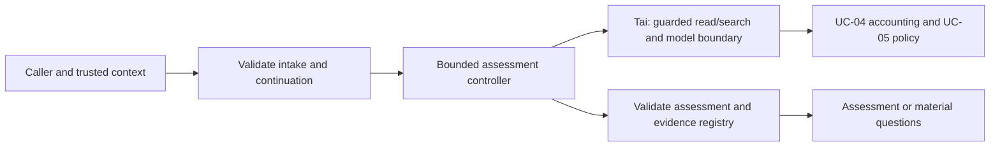

# Implementation Plan: UC-01 Evidence-backed Issue Triage

**Branch**: `feat/012-uc01-issue-triage-specs` | **Date**: 2026-10-17 | **Spec**: [spec.md](spec.md)

**Input**: Draft specification in `specs/002-uc01-issue-triage/`.
**Status**: Existing baseline approved by the user on 2026-10-18 for T001 documentation/review. Consumer signatures and the numeric fixture profile are approved through user-confirmed member agreement in [decisions](contracts/decisions.md). No runtime implementation authorization.

## Summary

Thai owns an assessment boundary for one issue/repository. Validate input and trusted catalogs; collect bounded evidence through Tai's shared read/search tools; ask the model for a structured assessment; validate provenance and values; return an assessment or material questions. Preserve original report. Recommend without dispatching. No dedicated rewrite call.

## Technical Context

**Language/Version**: Proposed consumer uses approved TypeScript 6.0.3, Node.js 24 LTS, strict NodeNext ESM.
**Primary Dependencies**: Existing LangGraph and Node built-ins; no new package proposed. Graph wiring consumes shared ports rather than new tools.
**Storage**: No UC-01 store. UC-04 supplies durable task accounting and continuation storage; fixtures are explicitly in-memory.
**Testing**: Evaluation-first at each slice using Node contract/behavior tests and controlled ports, followed by actual integration and held-out/shared evaluation; [acceptance](contracts/acceptance.md) and proposed [evaluation contract](contracts/evaluation.md).
**Target Platform**: Host harness; approved target repository read boundary owned by Tai. Deployment/API transport remains open.
**Project Type**: Internal runtime assessment module, with no CLI/service framework selected.
**Performance Goals**: Finite configured invocation deadline and call ceilings; numeric production values and measured quality thresholds require approval, not invented defaults.
**Constraints**: No writes, commands, reproduction, debugging, recovery engine, approval engine or dispatch in UC-01.
**Scale/Scope**: One issue, one repository per invocation; initial repository scope follows [overview](../../context/project_overview.md).

## Constitution Check

The [constitution](../../.specify/memory/constitution.md) remains an unratified template. Apply AGENTS.md, accepted ADR-0005 and repository policy instead of treating placeholder principles as ratified. Pre-research and post-design gates: scope limited to planning (PASS); shared owners preserved (PASS); production choices explicitly gated (PASS); no UC-03 contract mutation (PASS). Runtime readiness is BLOCKED pending [decisions](contracts/decisions.md), regardless of draft completeness.

## Project Structure

### Documentation (this feature)

`specs/002-uc01-issue-triage/` owns spec, plan, research, data-model, quickstart, checklists, contracts and the sole implementation ledger `tasks.md`. `.specify/feature.json` selects this feature without renaming UC-03. Local reviews/ticket proposals stay ignored in `.agent-work/2026-10-17/uc01-sdd/`.

### Source Code (repository root)

Agreed UC-01 ownership paths; none created by T001:

```text
src/uc01/
  contracts.ts          # assessment-specific parsing and validation
  intake.ts             # original issue/config/continuation binding
  assess.ts             # assessment use case through injected ports
  clarify.ts            # question and answer projection
  recommend.ts          # catalog-constrained destination recommendation
  compose.ts            # shared-port consumer wiring; production admission
tests/runtime/uc01/
  contract.test.ts, intake.test.ts, assess.test.ts
  clarify.test.ts, recommend.test.ts, integration.test.ts, safety.test.ts
tests/runtime/support/uc01/
  fixtures.ts, ports.ts
```

**Structure Decision**: Thai owns only UC-01-specific modules/tests. Tai owns `src/contracts/uc03.ts`, `src/foundation/` and shared evaluation infrastructure; Thanh Tan owns `src/persistence/`; Trong Tan owns `src/approvals/`. Path allocation is approved at T001; no shared-file edits are hidden inside Thai's tasks.

## Architecture and module boundaries



UC-01 receives only narrowed read/search capabilities, not a full RepositoryPort with patch/execute methods. Model tool requests are data checked against that narrow capability set; the controller invokes only validated read/search requests. All operation guards and durable reservations are shared. No UC-03 bug workflow is required to run UC-01 fixtures.

The existing executable ModelPort requires UC-03 TaskState/ModelProposal, and RepositoryPort does not expose the full contextual denial envelope UC-01 needs. These cannot be assumed triage-compatible. [Shared interfaces](contracts/interfaces.md#versioned-consumer-signatures) now supplies `uc01-consumer-v1`, including a separate triage role, guarded read/search, accounting, continuation and additive evidence projection. [Schema](contracts/schema.md#finite-controlled-fixture-profile) supplies the concrete `uc01-fixture-v1` numeric test profile. X-FOUNDATION-AGREEMENT is satisfied for this consumer contract; T002 onward still needs separate implementation authorization and real integrations retain their delivery gates. Do not fake a bug TaskState or copy the provider budget implementation. Preserve canonical SourceEvidence, including boundedExcerpt, and transform only at an agreed boundary.

## Implementation strategy and execution

1. Approve the draft and agree consumer contracts/path ownership with shared owners (T001). No implementation starts from this PR.
2. Validate assessment contracts and build controlled fixtures/spies (T002–T004), distinct from real adapters. This makes independent progress possible after contract agreement.
3. Implement US1 through mocked shared ports (T005–T006); demo classified issue plus evidence-linked severity with zero side effects. This is the first vertical slice and includes setup/foundation prerequisites.
4. Extend US1 to later-answer clarification (T007–T008), then catalog recommendation cases (T009–T010); retain independently runnable story tests.
5. Integrate real shared foundation/policy/accounting only when delivered and approved (T011–T012); do not replace unavailable ports with production mocks. Receiving-workflow compatibility is validated without dispatch (T013).
6. T014 consolidates safety regressions already exercised at the earliest owning slices; it is not their first execution point. T015 runs real-model comparisons and proves shared evaluation registration using data/rules designed at T002–T004. Authorize paid/provider runs separately with finite approved config. T016 reconciles accumulated evidence and all runtime gates before any capability update.

At every step: define behavior and freeze relevant case/oracle/rule versions before implementation; execute available checks immediately after implementation; record pass/fail/error/not-run plus actual evidence; run impacted regressions; accept only that task's declared level/scope when complete. Deferred real checks retain explicit blockers and never inherit mock passes. T001–T016 and all six ticket groupings are preserved; no extra evaluation task ledger or runner is introduced.

## Evaluation architecture and observed baseline

Inspection at source 2763d4a on 2026-10-17 found package scripts for typecheck/lint/build/runtime validation, `tests/runtime/` bootstrap plus UC-03 contract/mocks, and contributor/runtime Ubuntu/Windows CI. There is no `evals/`, UC-01 runtime/test suite, registered case catalog or shared evaluation runner. Existing Node tests are useful local verification infrastructure; neither those tests nor CI establish model accuracy or one-command project evaluation.

T002 designs/validates the proposed case/result/grading records; T003 supplies finite mock responses and trace/call spies; T004 prepares C01–C22 cases/oracles and held-out corpus design before T005–T010 behavior work. Each functional slice consumes those records in ordinary Node tests. Tai owns future case discovery, grader infrastructure, project selection/orchestration and reporting; Thai owns UC-01 case content and consumer compatibility. The [evaluation contract](contracts/evaluation.md) defines IDs, versions, isolation, status/metric semantics, aggregation and registration without choosing an unapproved runner command or implementation path.

X-EVAL-AGREEMENT approves shared registration/result signatures with Tai; X-EVAL-RUNNER supplies a tested real version. These gate T015 shared registration, not early approved local contract/mock slices. When the runner is absent, local tests still produce level-specific evidence and shared-integration cases stay not-run. T015 needs actual scoped registration, failure propagation and cross-UC isolation evidence; a full-project claim additionally requires the owner's required-UC/case manifest and all external deliveries. T016 distinguishes UC-01 runtime acceptance from whole-project evaluation.

## Verification strategy

- Trace each FR to acceptance cases and implementation tasks; validate schema shapes, citation membership, severity dimensions and question/answer binding.
- Unit/contract tests use disjoint owned paths and deterministic fixtures; no live GitHub issue fetching, network, provider access, commands or actual recovery is implied.
- Attack tests cover injected tools, path escape, protected content, stale continuation, malformed citations, absent/exhausted budgets and uncertain provider usage at the first slice capable of observing them, not only T014. Shared guards must prevent effects before denial; mock guard-ordering evidence is separate from real containment evidence.
- Integration consumes versioned shared adapters with `real` provenance and records immutable revisions/config identities; perform actual UC-04 restart and UC-05 pause/resume acceptance jointly. Clarification itself is a needs-info result, not a durable wait implementation.
- Compare two equivalent held-out real-model runs with machine-readable metrics, hidden labels outside model/tool context, the user-supplied 80% classification floor and owner-approved remaining thresholds. Retain case failures and completeness separately from aggregate scores. Deterministic schema passes never prove model judgment quality.
- Planning gates: context checker, runtime baseline validator and full Node suite. Those checks validate existing repository integration only; no UC-01 runtime exists in this change.

## Dependencies and release gates

See [tasks.md](tasks.md) for internal DAG and [decisions](contracts/decisions.md) for owner gates. X-FOUNDATION-AGREEMENT gates agreed mocks; X-READ-MODEL and X04-STATE/X05-GATE gate real integration; X-RECEIVER gates recommendation compatibility only. UC-03 repair implementation is not a prerequisite. All are external deliveries, not duplicated UC-01 tasks.

## Complexity Tracking

No governance exception proposed. Narrow consumer seams are necessary because existing bug-specific types are incompatible with triage; shared adapters remain owned by their current owners.
