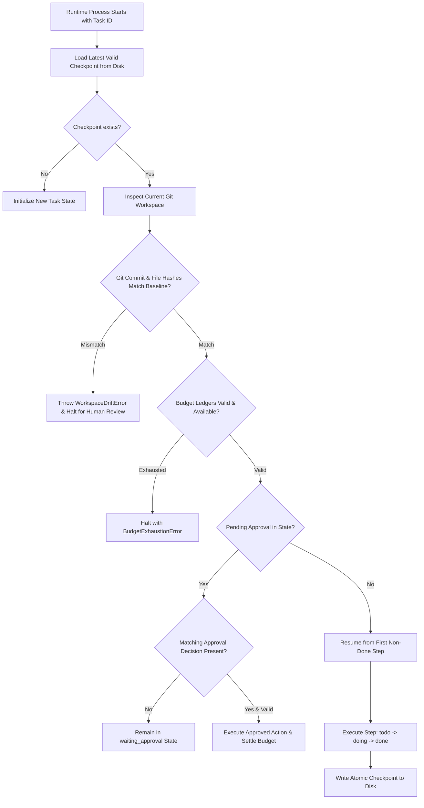

# Implementation Plan: UC-04 Multi-Step Feature with Resume & Human-in-the-Loop

**Branch**: `feat/004-multi-step-feature-resume` | **Date**: 2026-10-19 | **Spec**: [spec.md](./spec.md)  
**Owner**: Thanh Tan | **Collaborators**: Tai (Foundation), Trong Tan (UC-05 Approval)

---

## 1. Summary & Technical Approach

UC-04 provides the authoritative runtime engine for **State, Checkpoint, Memory, and Recovery** in slop-loop.
The approach couples **deterministic file-based persistence** (using atomic filesystem primitives and SHA-256 state hashing) with **LangGraph orchestration** via a custom `DurableFileCheckpointer`. 

Key architectural components:
1. **Durable State Engine**: Atomic write operations, monotonic state versioning, locking to prevent concurrent mutations.
2. **Step State Engine**: Formal state machine for multi-step task execution (`todo` -> `doing` -> `done` / `failed`).
3. **Restart Recovery & Workspace Reconciliation**: Process restart loader that inspects git HEAD, working tree cleanliness, and expected file hashes before allowing execution to resume.
4. **Cumulative Two-Phase Budget Accounting**: Atomic reservations (`reserve`), settlement (`settle`), and uncertain reconciliation (`reconcileUncertain`) that persist across process restarts and prevent runId resets from clearing consumption.
5. **Human-in-the-Loop Workflow Integration**: Graph interrupt mechanism that yields when a step requires human approval, persisting a cryptographic binding of the action, repository revision, and policy version.
6. **Context Compactor & Long-Term Memory**: Structured summarizer extracting essential invariants (`goal`, `constraints`, `risks`, `nextAction`) and advisory cross-task repo memory.

---

## 2. Technical Context

- **Language / Runtime**: Node.js 20+ / 24+ ES Modules with strict TypeScript (`strict: true`, zero `any`).
- **Orchestration**: `@langchain/langgraph` (v1.5.0), `@langchain/core` (v1.2.17).
- **Storage**: Structured JSON files in `.agent-work/state/` with atomic write (`wx` flag, `.tmp` file, `fsync`, `rename`), file-based locking.
- **Hashing & Integrity**: Node.js `node:crypto` (`createHash('sha256')`) for state digests and workspace assumption verification.
- **Git Integration**: `git status --porcelain`, `git rev-parse HEAD`, `git diff --name-only` for workspace validation.
- **Testing**: Node.js built-in test runner (`node --test`), TypeScript compilation (`tsc`).

---

## 3. Architecture & Concrete Code Structure

```text
src/
├── state/
│   ├── types.ts              # Data contracts: TaskState, StepState, Checkpoint, BudgetLedger, ApprovalBinding
│   ├── durable-store.ts      # Atomic file I/O, file locks, version checks, serialization
│   ├── step-machine.ts       # Step transitions (todo -> doing -> done | failed) & validations
│   ├── budget-tracker.ts     # Two-phase reservation, settlement, uncertain outcome reconciliation
│   ├── reconciliation.ts     # Workspace assumption validator (git commit, dirty state, file hashes)
│   └── checkpointer.ts       # LangGraph BaseCheckpointSaver implementation (DurableFileCheckpointer)
├── workflow/
│   ├── graph.ts              # LangGraph StateGraph definition for multi-step feature execution
│   └── human-pause.ts        # Human-in-the-loop pause, approval binding, and safe resumption logic
├── memory/
│   ├── compactor.ts          # Structured context compaction retaining goal, state, risks, next action
│   └── long-term-store.ts    # Advisory repository memory (conventions, commands, durable constraints)
└── contracts/
    └── uc04.ts               # Public validation schemas and type guards

tests/runtime/uc04/
├── durable-store.test.ts     # Tests for atomic file writing, locks, and corrupted state protection
├── step-machine.test.ts      # Tests for step state transitions, idempotency, and invalid moves
├── restart-recovery.test.ts  # True cross-process restart tests, workspace drift detection
├── budget-accounting.test.ts # Cumulative budget survival across restarts, reservation settlement
├── human-pause.test.ts       # Pause on risky action, resume on approval, rejection on drift
├── compactor.test.ts         # Long-context compaction preserving mandatory fields
├── long-term-memory.test.ts  # Advisory memory CRUD and verification against code facts
└── e2e-workflow.test.ts      # End-to-end multi-step feature execution with simulated crash & resume
```

---

## 4. Detailed Component Design

### 4.1. Data Models (`src/state/types.ts`)

```typescript
export type StepStatus = 'todo' | 'doing' | 'done' | 'failed';

export interface PlanStep {
  readonly id: string;
  readonly title: string;
  readonly description: string;
  readonly status: StepStatus;
  readonly startedAt?: string;
  readonly completedAt?: string;
  readonly error?: string;
  readonly changedFiles?: readonly string[];
  readonly verificationRef?: string;
}

export interface TaskState {
  readonly taskId: string;
  readonly runId: string;
  readonly taskType: 'feature' | 'bugfix' | 'refactor';
  readonly goal: string;
  readonly acceptanceCriteria: readonly string[];
  readonly constraints: readonly string[];
  readonly plan: readonly PlanStep[];
  readonly currentStepIndex: number;
  readonly changedFiles: readonly string[];
  readonly status: 'pending' | 'running' | 'waiting_approval' | 'completed' | 'failed';
  readonly stateVersion: number;
  readonly lastCheckpointId?: string;
  readonly budgetLedgers: readonly BudgetLedger[];
  readonly pendingApproval?: ApprovalRequestBinding;
  readonly workspaceBaseline: WorkspaceBaseline;
  readonly openRisks?: readonly string[];
  readonly nextAction?: string;
}

export interface WorkspaceBaseline {
  readonly commitHash: string;
  readonly branch: string;
  readonly isClean: boolean;
  readonly trackedFilesHash: string;
}

export interface ApprovalRequestBinding {
  readonly requestId: string;
  readonly actionType: string;
  readonly targetFiles: readonly string[];
  readonly normalizedActionDigest: string;
  readonly repoCommit: string;
  readonly policyVersion: string;
  readonly createdAt: string;
}
```

### 4.2. LangGraph Custom Checkpointer (`src/state/checkpointer.ts`)

Implements LangGraph's `BaseCheckpointSaver`:
- `put(config, checkpoint, metadata)`: Serializes thread state, validates data integrity, and commits atomically to `.agent-work/state/checkpoints/<thread_id>/<checkpoint_id>.json`.
- `getTuple(config)`: Reads latest checkpoint from disk, validates integrity checksum, and returns `CheckpointTuple`.
- `list(config)`: Lists all persisted checkpoints ordered by version/timestamp.

### 4.3. True Process Restart Workflow (`src/state/reconciliation.ts`)



---

## 5. Implementation Phases & Milestones

- **Phase 1: Foundational Storage & Contracts**: Types, atomic store, locking, step state machine.
- **Phase 2: Budget Accounting & Reservation**: Cumulative budgets, two-phase reservations, uncertain outcome handling.
- **Phase 3: Restart Recovery & Workspace Reconciliation**: Process recovery, git baseline validation, drift protection.
- **Phase 4: Workflow Orchestration & Human-in-the-Loop**: LangGraph custom checkpointer, approval pause/resume, UC-05 binding.
- **Phase 5: Context Compaction & Long-Term Memory**: Structured summarizer, advisory repository memory store.
- **Phase 6: E2E Verification & Chaos/Crash Suite**: True process restart tests, simulated crashes during reservations, audit logging.
