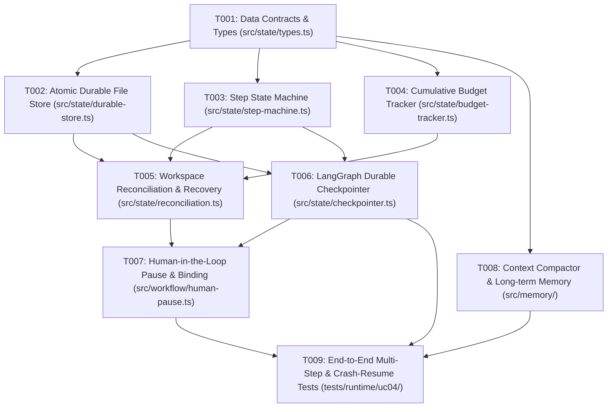

# Tasks: UC-04 Multi-Step Feature with Resume & Human-in-the-Loop

**Input**: Design documents from `/specs/004-uc04-multi-step-feature/` (`spec.md`, `plan.md`)  
**Feature Branch**: `feat/004-multi-step-feature-resume`  
**Status**: Completed  
**Owner**: Thanh Tan

---

## Task Summary & Dependency Graph

---

## Phase 1: Setup & Data Contracts (Foundational)

- [x] **T001**: Implement Type Definitions & Data Validation Schemas
  - **Path**: `src/state/types.ts`, `src/contracts/uc04.ts`
  - **Blocked by**: None (can start immediately)
  - **Description**: Define strict TypeScript interfaces for `TaskState`, `PlanStep`, `StepStatus` (`todo`, `doing`, `done`, `failed`), `BudgetLedger`, `ReservationBundle`, `ApprovalRequestBinding`, `WorkspaceBaseline`, and runtime validation guards.
  - **Verification**: `node --test dist/tests/runtime/uc04/types.test.js` (Passed 6/6 tests)

- [x] **T002**: Implement Atomic Durable File Store with Concurrency Locking
  - **Path**: `src/state/durable-store.ts`, `tests/runtime/uc04/durable-store.test.ts`
  - **Blocked by**: T001
  - **Description**: Implement file persistence using atomic write (`.tmp` write, `fsync`, atomic `rename`) and non-reclaimed file locks (`.lock`) to ensure corruption-free disk persistence.
  - **Verification**: `node --test dist/tests/runtime/uc04/durable-store.test.js` (Passed 4/4 tests)

- [x] **T003**: Implement Step State Machine & Checkpoint Transitions
  - **Path**: `src/state/step-machine.ts`, `tests/runtime/uc04/step-machine.test.ts`
  - **Blocked by**: T001
  - **Description**: Implement deterministic state transition logic for plan steps. Enforce strict transition rules (`todo` -> `doing` -> `done` or `failed`). Enforce monotonic `stateVersion` bumping on each transition.
  - **Verification**: `node --test dist/tests/runtime/uc04/step-machine.test.ts` (Passed 6/6 tests)

---

## Phase 2: Budgeting & Restart Recovery

- [x] **T004**: Implement Cumulative Budget Ledger with Atomic Two-Phase Reservations
  - **Path**: `src/state/budget-tracker.ts`, `tests/runtime/uc04/budget-accounting.test.ts`
  - **Blocked by**: T001
  - **Description**: Implement durable budget accounting for tokens, API cost, repair cycles, and reviewer iterations. Support atomic `reserve()`, `settle()`, and `reconcileUncertain()`. Guarantee allowances survive across runs and process restarts without resetting.
  - **Verification**: `node --test dist/tests/runtime/uc04/budget-accounting.test.js` (Passed 5/5 tests)

- [x] **T005**: Implement Process Restart Recovery & Workspace Assumption Reconciliation
  - **Path**: `src/state/reconciliation.ts`, `tests/runtime/uc04/restart-recovery.test.ts`
  - **Blocked by**: T002, T003, T004
  - **Description**: Implement process resume engine that restores state from the latest checkpoint on disk, captures live git status (`git rev-parse HEAD`, clean/dirty check, file SHA-256 digests), and validates against saved `WorkspaceBaseline`. Detect drift and reject unsafe resumes.
  - **Verification**: `node --test dist/tests/runtime/uc04/restart-recovery.test.js` (Passed 3/3 tests)

---

## Phase 3: LangGraph Integration & Human-in-the-Loop

- [x] **T006**: Implement LangGraph Custom Durable Checkpointer
  - **Path**: `src/state/checkpointer.ts`, `tests/runtime/uc04/checkpointer.test.ts`
  - **Blocked by**: T002, T003
  - **Description**: Implement LangGraph's `BaseCheckpointSaver` interface backed by `DurableStore`. Enable LangGraph workflows to checkpoint state at every node execution boundary.
  - **Verification**: `node --test dist/tests/runtime/uc04/checkpointer.test.js` (Passed 2/2 tests)

- [x] **T007**: Implement Human-in-the-Loop Workflow Pause, Approval Request Binding, and Resumption
  - **Path**: `src/workflow/human-pause.ts`, `tests/runtime/uc04/human-pause.test.ts`
  - **Blocked by**: T005, T006
  - **Description**: Implement graph interrupt mechanism for actions requiring human approval (UC-05 integration). Generate cryptographic approval binding (`actionDigest + commitHash + policyVersion`), set task status to `waiting_approval`, and safely persist. On resume, validate human decision and binding before continuing.
  - **Verification**: `node --test dist/tests/runtime/uc04/human-pause.test.js` (Passed 4/4 tests)

---

## Phase 4: Context Compaction & Long-Term Memory

- [x] **T008**: Implement Context Compactor & Advisory Long-Term Memory Store
  - **Path**: `src/memory/compactor.ts`, `src/memory/long-term-store.ts`, `tests/runtime/uc04/compactor.test.ts`, `tests/runtime/uc04/long-term-memory.test.ts`
  - **Blocked by**: T001
  - **Description**: Implement structured context compactor extracting `goal`, `constraints`, `completedSteps`, `currentState`, `openRisks`, and `nextAction`. Implement persistent advisory repo memory store for conventions and commands across sessions.
  - **Verification**: `node --test dist/tests/runtime/uc04/compactor.test.js dist/tests/runtime/uc04/long-term-memory.test.js` (Passed 4/4 tests)

---

## Phase 5: End-to-End Verification & Real Process Chaos Testing

- [x] **T009**: Implement End-to-End Multi-Step Feature Workflow & Process Crash Suite
  - **Path**: `src/workflow/feature-workflow.ts`, `tests/runtime/uc04/e2e-workflow.test.ts`
  - **Blocked by**: T006, T007, T008
  - **Description**: Build full end-to-end integration test: execute a real 3-step feature task on a fixture repository. Simulate real process termination (SIGKILL) mid-flight, restart via new Node subprocess, confirm zero duplicate work, verify budget continuity, execute human approval pause/resume, and complete with delivery report.
  - **Verification**: `node --test dist/tests/runtime/uc04/e2e-workflow.test.js` (Passed 2/2 tests; total 36/36 tests passed)
